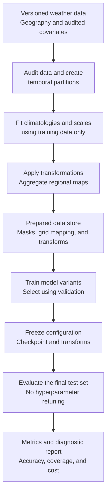
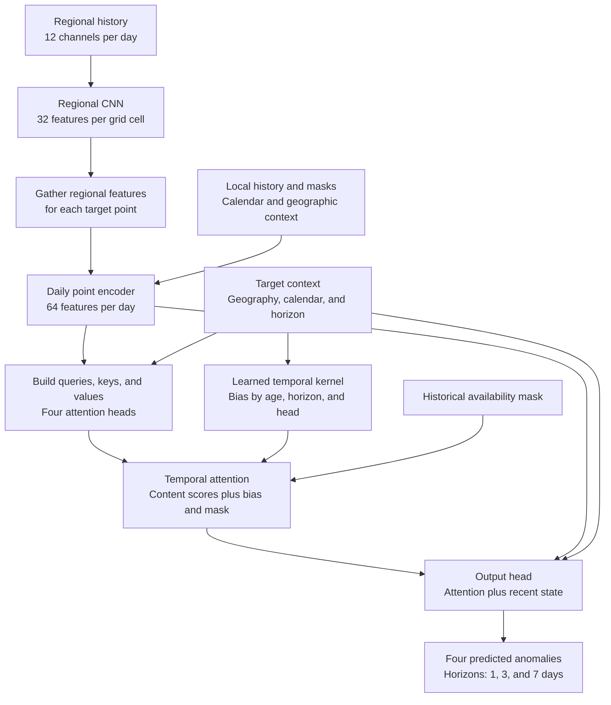
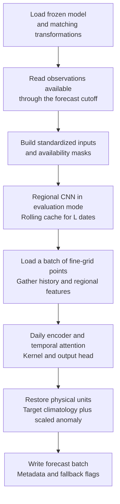

# PISCO Variable Prediction Model Architecture

Implementation and evaluation document · Revised version: September 23, 2026

> **Authorship and status.** Draft prepared with assistance from Claude and reviewed with assistance from ChatGPT. The architecture and hyperparameters are experimental proposals; no training results are attached. The team must confirm the data inventory and provenance before running the experiments.

## 1. Objective and scope

Predict four daily variables—`td`, `sd`, `tmin`, and `tmax`—for valid cells of a fine grid with a nominal resolution of $0.01^\circ$. At the end of day $t$, produce direct forecasts for $t+1$, $t+3$, and $t+7$, using only information available through $t$.

According to the draft inventory, `td` is dew-point temperature, `sd` is sunshine duration, `tmin` is minimum temperature, and `tmax` is maximum temperature. **Confirm these definitions, units, and daily aggregation methods in the metadata.** Do not treat `sd` as radiation without verification. This version covers these four variables; precipitation and observed daily wind are not dynamic inputs in this configuration.

Train on standardized anomalies. The model combines each cell's history with daily regional maps at a nominal resolution of $0.10^\circ$. A learned function modifies temporal attention weights according to observation age, location, season, and forecast horizon.

This is not a historical reconstruction model that uses observations after the forecast cutoff, nor an autonomous climate simulation of future years. Evaluation consists of successive forecasts: as the cutoff advances, the corresponding historical observations become available according to their actual availability.

## 2. Data requiring confirmation

The following values come from the draft and have not been checked against the data files:

| Item | Working value | Required verification |
|---|---|---|
| Common period | 1981–2016 | Calendar, missing values, and availability by variable |
| Fine resolution | $0.01^\circ$ | Coordinates, cell centers, boundaries, and row orientation |
| Number of valid cells | Approximately 2.18 million | Actual mask and count for each product |
| Regional resolution | $0.10^\circ$ | Alignment with the fine grid |
| Regional map dimensions | $199\times143$ | Derive from the actual extent; do not hard-code without checking |
| Geographic metadata | Latitude, longitude, DEM, and TDI | Units, coverage, and the exact definition of TDI |
| Optional covariates | Monthly wind normals, daytime LST, and nighttime LST | Source, reference period, and absence of temporal leakage |
| Environmental classes | Number not yet confirmed | Legend, version, provenance, and treatment of glaciers |

DEM means digital elevation model; LST means land surface temperature. Document the definition of TDI: do not replace the original product with a similarly named topographic index.

**Monthly normals are not constant throughout the year.** They comprise twelve maps per variable, selected for the relevant month. They do not replace observed daily wind or provide the actual daily wind direction.

The primary configuration uses only covariates with audited provenance. If external normals cannot be shown to be compatible with the temporal split, run the model without them first. The same rule applies to environmental classifications constructed from validation or test data. Such inputs may be investigated separately as retrospective external context, but that comparison must be explicitly labeled.

## 3. Notation and initial configuration

| Symbol | Meaning |
|---|---|
| $r$ | Target fine-grid cell |
| $s$ | Date of a historical observation |
| $t$ | Last available day when the forecast is issued |
| $\ell\in\{1,3,7\}$ | Forecast horizon, in days |
| $j\in\{0,\ldots,L-1\}$ | Observation age: $s=t-j$ |
| $L$ | Number of daily input observations; initially 60 |
| $v$ | Weather variable; fixed order: `td`, `sd`, `tmin`, `tmax` |
| $m$ | Attention head; four heads with 16 components each |
| $B$ | Fine-grid cells in a batch, all sharing the same cutoff in the initial implementation |
| $H_c,W_c$ | Actual height and width of the regional map |
| $D_c$ | Dimension of geographic and, optionally, monthly context |
| $C_R$ | Regional feature dimension: 32 with the CNN; 0 without the regional branch |

With $L=60$, the history is $t-59,\ldots,t$, not sixty days before and after $t$. The maximum $L$ limits the available information. The kernel learns how to weight it but cannot retrieve observations preceding that window.

Initial configuration: 64-component daily representations, four attention heads, a regional CNN with 32 channels, and joint prediction of the four variables. These settings require experimental validation.

## 4. Temporal split and data preparation

### 4.1. Partitions

| Use | Period | Permitted operations |
|---|---|---|
| Training | 1981–2004 | Fit weights, climatologies, scales, and learned imputation procedures |
| Validation | 2005–2010 | Select architecture, windows, hyperparameters, and checkpoint |
| Final test | 2011–2016 | Evaluate frozen configurations |

Assign samples according to **their target dates**, rather than randomly splitting overlapping windows. For joint training at three horizons, all targets of a sample must belong to the same partition. Discard samples whose targets cross a partition boundary. Historical context preceding a boundary is allowed because it was already available.

A sample is a pair $(r,t)$ with a historical sequence and three target dates. Not every initial date yields a sample: the specified history window must be available. Compare different window lengths using the same target dates eligible for the longest window in the experiment.

Also inspect the source product: retrospective filling with future observations can compromise the operational interpretation even when the model code respects the cutoff.

### 4.2. Climatology and scaling

For each cell and variable, estimate a day-of-year climatology using training data only. Calculate the historical mean for each calendar day and apply 31-day circular smoothing, accounting for the number of valid observations. Define a reproducible policy for days with insufficient data.

Use a climatological calendar with 365 positions: keep months and days aligned across leap years. For February 29, interpolate between the climatologies for February 28 and March 1. Apply the same convention to cyclic calendar features and document the implementation.

Define:

$$
A_{r,v,s}=X_{r,v,s}-C_{r,v}(d(s)),
\qquad
Z_{r,v,s}=\frac{A_{r,v,s}}{\sigma_v}.
$$

$C$ is the climatology, $d(s)$ is the calendar position, and $\sigma_v$ is a positive scale estimated from training anomalies, shared across locations for each variable. Save the estimator, the population used to estimate it, and a numerical floor for degenerate scales.

This transformation lets learning focus on departures from the mean cycle. Its benefit is a modeling hypothesis: no specific fraction of variance explained by climatology is assumed for all variables.

Reconstruct the output as:

$$
\widehat X_{r,v,t+\ell}
=C_{r,v}(d(t+\ell))+\sigma_v\widehat Z_{r,v,t+\ell}.
$$

### 4.3. Missing data and calendar features

Store a mask for each variable: $O_{r,v,s}=1$ if the value is available at the cutoff, and $0$ otherwise. Replace missing anomalies with zero **after recording the mask**. Do not confuse this fill value with an observed zero anomaly.

Represent the calendar using two components:

$$
c_s=\left[\sin(2\pi p_s),\cos(2\pi p_s)\right],
$$

where $p_s$ is the annual phase consistent with the convention above. The future calendar is known; future weather observations are not.

Exclude missing targets from the loss and metrics. Do not impute them and treat the imputed values as observed ground truth.

## 5. Regional and point-level input construction

### 5.1. Geographic context and monthly normals

Define the static vector:

$$
g_r=[\operatorname{lat}_r,\operatorname{lon}_r,\operatorname{DEM}_r,\operatorname{TDI}_r].
$$

If audited normals are enabled, define $n_{r,\operatorname{month}(s)}$ using three monthly values: wind, daytime LST, and nighttime LST. The context for a date is:

$$
d_{r,s}=
\begin{cases}
g_r, & \text{without normals: }D_c=4,\\
[g_r;n_{r,\operatorname{month}(s)}], & \text{with normals: }D_c=7.
\end{cases}
$$

Use the month of $s$ for historical inputs, and the month of $t+\ell$ for the query and output head. Standardize continuous covariates with saved statistics, without weather information from validation or test periods. Standardization does not remove leakage already present in the source of a normal.

For the pilot, enable normals only when coverage is consistent across the evaluated cells. If partial missingness is allowed later, add covariate masks and update $D_c$ and all derived dimensions; do not fill values silently.

### 5.2. Fine-grid aggregation

If the grids are aligned, each regional cell corresponds to a nominal $10\times10$ block of fine cells. Confirm alignment, boundaries, and orientation before using integer indices. If the grids are not aligned, construct a reproducible table of geographic intersections and aggregation weights.

For regional cell $c$, define the average of valid anomalies:

$$
\overline Z_{c,v,s}=
\frac{\sum_{r\in c}w_rD_rO_{r,v,s}Z_{r,v,s}}
{\sum_{r\in c}w_rD_rO_{r,v,s}},
$$

where $D_r$ indicates domain membership and $w_r$ is the cell area. If the denominator is zero, assign zero and mark availability as zero. Do not average zero-filled missing values as if they were observations.

Also calculate:

$$
F_{c,v,s}=\frac{\sum_{r\in c}w_rD_rO_{r,v,s}}
{\sum_{r\in c}w_rD_r},
\qquad
D_c^{\mathrm{map}}=\frac{\sum_{r\in c}w_rD_r}{\sum_{r\in c}w_r}.
$$

If a regional cell contains no valid domain, set its fractions to zero. $F$ measures availability within the domain; $D_c^{\mathrm{map}}$ measures the valid territorial fraction of the block. The superscript distinguishes this mask from the context dimension $D_c$.

**The twelve regional channels are:** four aggregated anomalies, four availability fractions, one domain fraction, and three geographic fields—DEM, latitude, and longitude. Standardize these three geographic fields; keep fractions between zero and one. TDI is not included in this initial CNN, although it is an input to the point-level encoder.

Set inputs outside the domain to zero and retain the mask. Areas outside the product do not represent observed ocean weather.

### 5.3. Mapping between grids

Precompute the index of the containing regional cell for every fine-grid cell. Store the mapping with the coordinates, resolution, and product version. The initial implementation gathers the vector from the containing cell; it does not use bilinear interpolation.

All fine-grid points within a regional cell share that regional vector, while retaining their own observations and fine-scale geographic information. Evaluate possible discontinuities at regional-cell boundaries. Introducing interpolation later is a model variant, not a silent implementation change.

## 6. Overall architecture

1. The CNN converts each historical regional map into 32 features per regional cell.
2. Each fine-grid point combines its observations, masks, calendar, geographic context, and regional vector into a 64-component daily representation.
3. One query per forecast horizon attends to these historical representations. The learned kernel adds a temporal bias to the scores.
4. The output head combines the attention output and the most recent state to predict four anomalies.
5. The saved climatology and scale convert anomalies back to original units.

Parameters are shared across dates and locations. A separate network is not trained for each point. The architecture has approximately $10^5$ parameters in order of magnitude; the implementation must print the exact count for each configuration.

### 6.1. Rationale for regional resolution

The team supplied a figure titled, in translation, “Variogram of td — PISCOeo_pm, January 16, 1981, full 0.01° grid.” Its caption states that the calculation uses x/y grid shifts over 2.18 million valid cells and a single pair of days. The image documents the diagnostic presented; its code has not been audited and its calculation has not been reproduced.

**What the figure shows:** at a separation of 17 km, the blue curve is marked at 12% of the variance and the orange curve at 2%. Both curves continue increasing over distances of hundreds of kilometers, without a clear plateau within the displayed range. The vertical axis indicates normalized semivariance, not a percentage of predictive information or variance explained by the CNN.

**Terminology correction:** the blue curve is labeled “daily anomaly,” but its definition is a difference between days:

$$
\Delta T_d(r,t)=T_d(r,t+1)-T_d(r,t).
$$

This is not the climatological anomaly used by the model:

$$
A_{r,\mathrm{td},t}=T_d(r,t)-C_{r,\mathrm{td}}(d(t)).
$$

Daily differencing reduces components that remain approximately constant from one day to the next, whereas a climatological anomaly removes a local seasonal reference. These are different diagnostics; do not substitute one for the other. Analyzing differences that include the next day is valid as a training-data diagnostic, but those differences cannot be predictors in a forecast issued at $t$.

For a field $Y$, the semivariance estimator at distance $h$ can be written as:

$$
\widehat\gamma_Y(h)=\frac{1}{2N_h}
\sum_{(r,r')\in P_h}\left[Y(r)-Y(r')\right]^2,
$$

where $P_h$ contains pairs at that distance or within a documented distance bin. Record the conversion from grid shifts to kilometers, the directions used, and the normalization denominators. Confirm whether each curve is divided by the variance of its own field; if so, their percentages do not directly compare absolute differences in degrees.

Under second-order stationarity and normalization by the variance of the same field, $\gamma_Y(h)/\sigma_Y^2=1-\rho_Y(h)$. A value of 12% would therefore be consistent with a correlation of 0.88, not a correlation of 12%. This interpretation is conditional: a nationwide aggregation with spatial trends, topography, and different directions does not guarantee those assumptions. [Relationship between semivariance and covariance, SAS](https://support.sas.com/documentation/cdl/en/statug/65328/HTML/default/statug_variogram_details05.htm).

**Design implication:** short-distance similarity makes a lower-resolution regional branch a reasonable experiment for expanding context at a controlled cost. The figure does not establish that nearby neighbors are useless, that the optimal context lies between 100 and 500 km, or that $0.10^\circ$ is the optimal resolution. In particular, a variogram measures spatial differences in the analyzed field, not the additional forecasting value of neighbors conditional on local history.

The plot labels a CNN over 15×15 fine-grid cells, approximately 17 km wide, as its “reach.” From the center to an outermost cell, there are seven grid steps: roughly 8 km along each axis at that resolution, not a 17 km radius. Always distinguish pairwise separation, receptive-field width, and center-to-neighbor reach. Section 7 applies the same distinction to the regional CNN.

**Validation before using the diagnostic as definitive justification:** repeat it on climatological anomalies of all four variables across multiple training dates, seasons, and regions. Retain daily differences as a complementary diagnostic. Separate x/y directions and, where useful, directions relative to terrain; record pair counts and variation across dates. Millions of grid cells do not replace diversity in weather situations. The sill and range of a semivariogram have specific definitions; do not identify the last plotted distance with the process range. [ArcGIS documentation on semivariograms](https://pro.arcgis.com/en/pro-app/3.6/help/analysis/geostatistical-analyst/semivariogram-and-covariance-functions.htm).

Retain the $0.10^\circ$ regional CNN in Section 7 as the first experiment. If it improves forecasts, separate two subsequent sensitivity studies: compare $0.05^\circ$ against $0.10^\circ$ with approximately equal physical receptive fields, and enlarge the receptive field while keeping $0.10^\circ$. Record changes in capacity and cost rather than attributing every difference to spatial scale. This distinguishes map resolution from context extent.

Moving from $0.01^\circ$ to $0.10^\circ$ reduces the number of cells over a comparable domain by approximately a factor of one hundred. It does not make the entire model one hundred times cheaper: the fine-grid temporal branch still exists.

The regional branch is a computational compromise. It may lose local interactions and orographic detail. The target's fine-grid history is retained, but a CNN over its fine-grid neighbors is not included. If errors justify it, evaluate an additional fine-scale spatial branch later.

## 7. Regional spatial encoder

### 7.1. Layers

Daily input: $[12,H_c,W_c]$. Daily output $R_s$: $[32,H_c,W_c]$.

| Stage | Operation | Channels | Dilation | Padding |
|---|---|---|---:|---:|
| Initial projection | Conv 1×1 + GELU | 12 → 32 | 1 | 0 |
| Residual 1 | One Conv 3×3 inside the block | 32 → 32 | 1 | 1 |
| Residual 2 | One Conv 3×3 inside the block | 32 → 32 | 2 | 2 |
| Residual 3 | One Conv 3×3 inside the block | 32 → 32 | 4 | 4 |
| Residual 4 | One Conv 3×3 inside the block | 32 → 32 | 8 | 8 |
| Final projection | Conv 1×1 | 32 → 32 | 1 | 0 |

All convolutions use stride 1 and mix input channels. Each block contains exactly **one** spatial convolution:

$$
U_{\mathrm{next}}=U+\operatorname{Dropout}\left(
\operatorname{GELU}\left(\operatorname{Conv}_{3\times3,d}
\left(\operatorname{LN}_{\mathrm{channels}}(U)\right)\right)\right).
$$

Use dropout 0.1 during training and disable it during evaluation. With convolutional biases and affine LayerNorm, this encoder has 38,720 parameters. Verify the count in the implementation; changing the block or its biases changes the count.

### 7.2. Receptive field and boundaries

The receptive field is **31 cells wide along each axis**:

$$
1+2(1+2+4+8)=31.
$$

At $0.10^\circ$, its north–south width is approximately 340 km. The distance from the center to the center of an outermost cell is fifteen grid steps, approximately 167 km along the north–south axis. **340 km is not the radius.** East–west distance depends on latitude, and distance to a corner is different.

This field does not by itself cover all relationships at 500 km. If more context is needed, expand the design and measure its effect.

Do not use pooling in the first implementation, to retain a straightforward correspondence between regional inputs and outputs. Reducing resolution and interpolating afterward is possible, but would be a different design.

Pad outside the rectangular map with zeros. Masks identify absent domain or observations; do not reflect values to invent conditions outside the product. Predictions near boundaries have incomplete spatial information and must be evaluated separately.

### 7.3. Normalization

LayerNorm operates **only over the 32 channels at each pixel**, not over height and width. In PyTorch, this can be implemented by temporarily moving channels to the final dimension and applying `LayerNorm(32)`.

Normalizing over the entire map would introduce dependence on positions outside the stated receptive field. BatchNorm is also omitted from this configuration because its statistics depend on batch composition; this does not imply that it is invalid in every model.

## 8. Daily point-level encoder

For each historical date $s=t-j$, concatenate:

$$
x_{r,s}=[Z_{r,:,s};O_{r,:,s};c_s;d_{r,s};R_s(c(r))].
$$

$c(r)$ is the containing regional cell. Omit the last term in variants without the regional branch.

The input dimension is:

$$
D_{\mathrm{daily}}=4+4+2+D_c+C_R=10+D_c+C_R.
$$

| Configuration | Dimension |
|---|---:|
| No regional branch or normals | 14 |
| No regional branch, with normals | 17 |
| With regional branch, no normals | 46 |
| With regional branch and normals | 49 |

Layers: `Linear(D_daily,64) → GELU → Linear(64,64) → LayerNorm(64)`.

The output is $H_{r,j}\in\mathbb R^{64}$, where $j=0$ corresponds to $t$. Store sequences in increasing order of observation age and verify this in tests. **Do not immediately apply a second LayerNorm to the same vector:** this version uses exactly the output normalization specified above.

## 9. Temporal attention and the learned kernel

### 9.1. Query, keys, and values

Construct one query for each location and forecast horizon:

$$
q_{r,\ell}=W_q\left[
H_{r,0};\overline H_{r,0:6};\Delta H_r;
d_{r,t+\ell};c_{t+\ell};e_\ell
\right].
$$

$e_\ell$ is an 8-component embedding for each of the three horizons. $\overline H_{r,0:6}$ is the mean of valid representations over the last seven days; use a zero vector if none is valid. Define $\Delta H_r=H_{r,0}-H_{r,1}$ when both tokens are valid, and zero otherwise. If the cutoff-day token is invalid, use zero for $H_{r,0}$ in the query and output head.

The input to $W_q$ has $202+D_c$ components: 206 without normals, or 209 with them. Its output has 64 components, split into four heads of 16.

For each day:

$$
k_{r,j}=W_k[H_{r,j};\log(1+j);j/30],
\qquad
v_{r,j}=W_vH_{r,j}.
$$

$W_k$ projects from 66 to 64 components, and $W_v$ from 64 to 64; split both outputs into four heads. Baseline attention already knows observation age through the keys. The divisor 30 is a fixed numerical scale: keep it unchanged when varying $L$.

### 9.2. Temporal validity mask

Availability is not determined solely by the local observation: local data may be missing while useful regional information exists.

For each point and date, consider the token valid when at least one condition holds:

- At least one of the four local observations is available.
- The regional branch is enabled and at least one valid dynamic observation exists within that point's regional receptive field.

Compute the second condition from the map's availability fractions by propagating an indicator of available support over the 31×31 neighborhood. Static fields alone do not make a token valid. If a minimum coverage fraction is required, document it as a different configuration; the initial rule requires some available support.

Set $M_{r,j}=0$ for valid tokens and $M_{r,j}=-\infty$ otherwise. Variable-specific masks remain encoder inputs, including for partially valid tokens.

If the entire window is invalid, skip softmax and the neural output head for that sample: return zero anomalies, equivalent to climatology, and flag the fallback reason in the output. Report fallback frequency. Do not compute gradients through an entirely masked row.

### 9.3. Kernel function

The kernel is a positive temporal weighting function, not a Mercer kernel. Its logarithm modifies attention scores:

$$
S_{r,\ell,m,j}
=\frac{q_{r,\ell,m}^{\top}k_{r,j,m}}{\sqrt{16}}
+b_{r,\ell,m}(j)+M_{r,j}.
$$

$$
a_{r,\ell,m,j}=\operatorname{softmax}_{j}(S_{r,\ell,m,j}).
$$

Adding $b$ is equivalent to multiplying content-based relevance by $K(j)=\exp(b(j))$ before normalization. Add $b$ directly in the implementation; do not compute unnecessary intermediate exponentials.

Define a learned geographic projection $z_r=W_zg_r\in\mathbb R^8$. In this version, $z_r$ contains static geography. Monthly normals, if available, enter the encoder, query, and output head, rather than $z_r$.

$$
\widetilde b_{r,\ell,m}(j)=f_\theta
\left[\log(1+j);j/30;z_r;c_{t+\ell};e_\ell;e_m\right],
$$

$$
b_{r,\ell,m}(j)=\widetilde b_{r,\ell,m}(j)-\widetilde b_{r,\ell,m}(0).
$$

Input dimensions of $f_\theta$:

| Component | Dimension |
|---|---:|
| Two representations of observation age | 2 |
| Geographic projection $z_r$ | 8 |
| Target calendar features | 2 |
| Horizon embedding $e_\ell$ | 8 |
| Head embedding $e_m$ | 4 |
| **Total** | **24** |

Network: `Linear(24,32) → GELU → Linear(32,32) → GELU → Linear(32,1)`. The MLP has 1,889 parameters with biases; projections and embeddings are counted separately.

Initialize the final layer's weights and bias to zero. This gives $b=0$ initially, and the attention operation matches the baseline when all other weights and inputs are identical. During the first step, only the generator's final layers may receive gradients. Check learning over several steps rather than requiring nonzero gradients in every layer immediately.

Anchoring sets $K(0)=1$ and makes curves easier to express relative to the most recent day. It does not enforce monotonicity, make parameters uniquely identifiable, or eliminate possible compensation between $b$ and the content score.

The final prediction error adjusts the shared function's parameters. There is no “correct kernel” label and no independent free parameter for every cell and day. Updating the network can change several lags simultaneously; do not interpret the gradient as a rule that independently raises the weight of one particular day.

### 9.4. Regularization and interpretation of curves

The optional smoothness penalty is:

$$
R=\operatorname{mean}\left(
\left[b(j+1)-2b(j)+b(j-1)\right]^2
\right),
\qquad j=1,\ldots,L-2,
$$

where the mean is taken **over the individually squared differences**, as well as over samples, horizons, and heads. The total loss adds $\eta R$, with $\eta\in\{0,10^{-4},10^{-3}\}$ as a limited sensitivity study. Select it using validation performance, not only the visual appearance of the curves.

Store $b(j)$, $K(j)$ for visualization, and final weights $a(j)$ separately. To avoid overflow in plots, normalize $K$ using a softmax of $b$, explicitly labeling it as the normalized kernel and distinguishing it from final attention.

Define the effective **attention** span as:

$$
d_{90}=\min\left\{d:\sum_{j=0}^{d}a(j)\ge0.9\right\}.
$$

It is measured from the most recent day and depends on content, masks, and the kernel. Do not calculate it by summing unnormalized $K$ values. An equivalent diagnostic of the normalized kernel must have a different label. Neither diagnostic is evidence of causality or a direct measurement of physical memory.

### 9.5. Temporal aggregation

For each head:

$$
u_{r,\ell,m}=\sum_{j=0}^{L-1}a_{r,\ell,m,j}v_{r,j,m}.
$$

Concatenate the four heads and apply `Linear(64,64)` to obtain $U_{r,\ell}$. This architecture uses three queries per point—one per horizon—rather than full self-attention between every pair of days. The number of temporal weights per point grows proportionally to $3\times4\times L$.

## 10. Output head and constraints

Construct:

$$
h_{r,\ell}^{\mathrm{output}}
=[U_{r,\ell};H_{r,0};d_{r,t+\ell};c_{t+\ell};e_\ell].
$$

Dimension: $138+D_c$, or 142 without normals and 145 with them.

Layers: `LayerNorm(D_output) → Linear(D_output,128) → GELU → Dropout(0.1) → Linear(128,4)`.

This LayerNorm operates on the entire concatenated vector; it is not a 64-channel LayerNorm. The output is $\widehat Z_{r,:,t+\ell}$; reconstruction in physical units follows Section 4.

**The shortcut concatenates the recent state.** It facilitates its use but does not impose exact persistence or automatically add today's anomaly. Baseline B1 does implement exact persistence. A residual output that predicts corrections to persistence would be a separate variant.

Initially train and evaluate raw outputs. Record inversions of `tmin` and `tmax` and impossible `sd` values. If `sd` is measured in sunshine hours, the interval 0–24 h is a basic check, not a sufficiently precise physical limit for every date and latitude; the local maximum depends on astronomical day length. Any projection or constraint must be documented, and results must also be evaluated before postprocessing. Do not impose relationships between `td`, `tmin`, and `tmax` without confirming their temporal aggregation methods.

## 11. Batching, map reuse, and memory

### 11.1. Initial batching rule

At each step, select **one cutoff $t$** and $B$ target cells from the spatial sample. All cells share the same $L$ historical dates. This organization makes it valid to reuse regional maps across points.

The CNN processes each historical date once during that step, and its vectors are gathered for the $B$ cells. The combined error updates the CNN, daily encoder, attention, kernel generator, and output head.

If a batch includes multiple cutoffs, gather the unique historical dates and store indices mapping each sample to those dates. The number of maps is no longer necessarily $L$. Do not use the following table unchanged in that case.

### 11.2. Tensor shapes

| Step | Shape with a shared cutoff |
|---|---|
| Regional input maps | `[L,12,Hc,Wc]` |
| Regional CNN output | `[L,32,Hc,Wc]` |
| Gathered regional vectors | `[B,L,32]` |
| Daily encoder input | `[B,L,10+Dc+Cr]` |
| Daily representations | `[B,L,64]` |
| Queries | `[B,3,4,16]` |
| Keys and values | `[B,4,L,16]` |
| Biases, logits, and weights | `[B,3,4,L]` |
| Temporal mask before broadcasting | `[B,1,1,L]` |
| Projected attention output | `[B,3,64]` |
| Output-head input | `[B,3,138+Dc]` |
| Predicted anomalies | `[B,3,4]` |

### 11.3. What can be cached

- **Before training:** regional input aggregates, coordinates, masks, climatologies, and the grid mapping, provided they correspond to the correct data version and partition.
- **Within a step:** regional features may be shared across points, and their gradients must be retained.
- **Not across CNN updates:** persistently reusing features computed with older weights breaks joint training. This is valid only if the CNN is explicitly frozen.
- **During inference:** with a fixed checkpoint, compute regional maps once per date and reuse them across point batches. Maintain a rolling cache of $L$ days. Disable dropout and use evaluation mode.

With $L=60$ and maps of $199\times143$, a single 32-channel activation contains 54,637,440 values: approximately 219 MB in float32. Multiple layers, gradients, and optimizer states require additional memory. An individual map being small does not establish that the full sequence fits on the GPU.

Measure memory and runtime using a pilot batch—for example $B=256$, adjusted to the hardware. If needed, use mixed precision and activation checkpointing/recomputation. Splitting the forward pass into chunks without releasing or recomputing computational graphs does not by itself remove the activations retained for backpropagation.

If full maps still do not fit, process regional tiles with a **fifteen-cell halo on each side**, retaining only their cores to avoid dependence on artificial padding between tiles. Verify equivalence in evaluation mode. This is a memory-dependent alternative, not an initial requirement.

## 12. Training, loss, and selection

Initially select approximately 50,000 cells using stratified sampling by region, elevation, and audited environmental classes. Save indices and sampling probabilities. This is a pilot, not proof of representativeness for the entire territory. The CNN may receive historical regional maps of the full domain even though supervision is computed only at selected points.

Sample eligible cutoffs throughout all training years. Do not load all windows into RAM or turn an entire day of two million points into one batch.

The supervised loss averages MSE across variables and horizons, with each MSE calculated over its valid targets:

$$
\mathcal L_{\mathrm{pred}}=
\frac{1}{|\mathcal A|}\sum_{(v,\ell)\in\mathcal A}
\frac{\sum_r T_{r,v,\ell}(\widehat Z_{r,v,t+\ell}-Z_{r,v,t+\ell})^2}
{\sum_r T_{r,v,\ell}},
$$

where $T$ is the target mask and $\mathcal A$ contains variable/horizon combinations with at least one valid target in the batch. Skip batches without valid supervision. Exclude samples handled by the climatology fallback from neural training, and report them when evaluating the complete system.

$$
\mathcal L=\mathcal L_{\mathrm{pred}}+\eta R.
$$

Standardization prevents dominance solely due to physical units; it does not guarantee identical difficulty or contributions across variables.

Initial settings: AdamW with learning rate $3\times10^{-4}$, weight decay $10^{-4}$, dropout 0.1 in the specified blocks, and gradient-norm clipping at 1. Train for up to 20,000 steps, validate every 1,000 steps, and stop after five validations without improvement. Record numerical precision, batch size, and the learning-rate policy; start with a constant rate to avoid implicit settings.

Select the checkpoint using standardized validation MSE on fixed samples and dates. If models are clearly undertrained, extend the finalists' budgets comparably. These are operational starting limits, not established optimal training durations.

## 13. Experiments and valid comparisons

Keep target dates, partitions, masks, normalization, permitted covariates, and selection criteria consistent. Comparisons are defined in pairs; the table does not imply that each row changes exactly one thing relative to the immediately preceding row.

### 13.1. Baselines

| ID | Model | Specification |
|---|---|---|
| B0 | Climatology | Predict zero anomalies |
| B1 | Anomaly persistence | Retain the most recent available anomaly for each variable within the window; use zero if none exists. Add the target date's climatology |
| B2 | Regularized linear regression with lags | Concatenate 2, 7, 14, 30, or 60 days of local anomalies and masks, calendar, and shared covariates. Fit one output per variable/horizon. Select regularization and window using validation |
| B3, if available | The project's previous local regression | Reproduce its definition and adapt it to one-sided forecasting without future observations |

B2 and B3 are different models. Lagged regression does not automatically reproduce local regression with a temporal kernel. Document whether B2 is shared across points or fitted separately per cell; the initial version proposes shared weights with geographic context.

### 13.2. Temporal variants without the regional branch

| ID | Temporal bias | Main comparison |
|---|---|---|
| T0 | $b=0$; observation age is included in the keys | Neural baseline |
| T1 | $b(j)=-j/\tau$ with a global scale selected using validation | T1 versus T0: a simple preference for recency |
| T2 | Flexible generator without geography or calendar | T2 versus T1 and T0: more flexible temporal parameterization |
| T3 | Flexible generator conditioned on geography and calendar | T3 versus T2: contextual conditioning |

In T2, replace the geographic and calendar inputs to $f_\theta$ with zeros to retain the same interface. Keep the head and horizon embeddings: there is a nationwide shared curve **for each head/horizon combination**, rather than a single universal curve. The query and output head retain their shared covariates.

T2 versus T1 also adds flexibility by head and horizon. If the improvement must be attributed exclusively to curve shape, add an exponential control with learned scales per head/horizon. Do not attribute differences to a single factor when several degrees of freedom change.

### 13.3. Spatial variants

| ID | Model | Comparison |
|---|---|---|
| S0 | T0 + regional CNN | S0 versus T0: combined contribution of regional information and encoder |
| S1 | T2 + regional CNN | S1 versus S0: flexible kernel within the same spatial architecture; S1 versus T2: regional contribution |
| S2 | T3 + regional CNN | S2 versus S1: kernel conditioning; S2 versus T3: regional contribution |
| S2-1×1 | S2 with Conv 3×3 layers replaced by Conv 1×1 | Context across regional cells versus using only the containing regional cell |

**Limitation of the 1×1 control:** it still observes an aggregation of a $10\times10$ fine-grid block and has fewer parameters than the 3×3 CNN. It is neither a model without spatial information nor a capacity-matched control. Report parameter counts; if the gain is small, add a wider 1×1 encoder with approximately matched capacity.

### 13.4. Sensitivity studies for finalists

- Window: $L\in\{30,60,90\}$, with retraining and the same eligible dates. Extend to 180 if improvements and cost justify it.
- Multi-output training versus four single-output models. Keep all four historical variables as predictors to isolate the effect of task sharing; removing predictors would be a separate experiment.
- Environmental class: add an 8-component embedding whose cardinality is read from the legend, including an unknown category. Do not hard-code 41 classes without checking. Concatenate it with geography; update $D_c$, the derived layers, and projection $W_z$, which still outputs eight components.
- Monthly normals: compare their presence and absence only after auditing provenance, while keeping the rest of the design unchanged.

One seed is sufficient for debugging and screening; repeat finalists and their controls with three seeds. Do not run the full Cartesian product of all variants from the outset.

## 14. Evaluation and diagnostics

Report RMSE, MAE, and bias in original units for each variable and horizon. For an error metric $E$, define skill relative to a baseline as $1-E_{\mathrm{model}}/E_{\mathrm{baseline}}$, identifying the metric and handling zero denominators explicitly.

Break down results by coast/Andes/Amazon region, elevation, season, and available environmental classes. Show sample sizes and valid coverage. Report territory-wide aggregation separately from averages across regions so that errors in small areas are not hidden.

First evaluate future dates at supervised locations, and also evaluate a representative sample of cells with no training targets. The second evaluation measures transfer to unsupervised locations, but not strict spatial isolation if their historical observations enter the regional CNN. State this distinction before extrapolating results to 2.18 million cells.

Estimate uncertainty using temporal and spatial blocks rather than treating every cell-day as independent. Report variability across seeds and the magnitude of improvements. Small differences require caution, rather than an automatic decision rule based only on three seeds.

Kernel and attention curves describe internal mechanisms, not identified physical correlations. Evaluate the contribution of older history by retraining with different windows and the contribution of neighbors through spatial ablations.

Reserve the test set for final evaluation of frozen configurations. Do not use its results to select hyperparameters again without acknowledging that it is no longer an untouched test set.

## 15. Checks before an expensive run

1. **Causality:** changing observations after the cutoff does not alter inputs, transformations, or predictions at that cutoff.
2. **Alignment:** fine and regional coordinates, DEM, TDI, and normals align. Manually verify several coastal and mountain cells.
3. **Reconstruction:** applying and then inverting climatology/scaling recovers valid observations within numerical tolerance.
4. **Aggregation:** zero-filled missing values do not affect averages. Fractions use the specified denominator and remain between zero and one.
5. **Tensors:** test dimensions with and without the CNN and normals. Verify variable order, horizon order, and observation-age order.
6. **Attention:** valid weights sum to one, masked positions have zero weight, and invalid windows return the fallback without NaNs.
7. **Gradients:** the CNN, projections, and kernel generator are updated during joint training. No stale feature caches or accidental `detach` operations interrupt the regional branch.
8. **Initial equivalence:** with $b=0$, logits match baseline attention when other weights are identical and dropout is disabled for the test.
9. **Small batch:** the model can overfit a few examples as a pipeline check, without presenting that result as predictive performance.
10. **Memory and boundaries:** profile the full sequence. If tiles are used, verify agreement with the full-map result in evaluation mode using the correct halo.

## 16. Data, training, and inference infrastructure

### 16.1. Components

- **Original storage:** weather files and geographic layers with versions and metadata preserved.
- **Preparation:** date/unit validation, grid indices, temporal splits, climatology/scale fitting, and regional aggregation. Use blockwise reads rather than materializing every possible window.
- **Prepared storage:** versioned fine-grid data, regional maps, masks, and transformations, for example in an array format supporting blockwise access and compatible with the environment.
- **Trainer:** a loader for one cutoff and multiple points, CPU-based batch preparation, and GPU execution if available. Measure actual hardware; neither a cluster nor a particular GPU is assumed.
- **Experiment registry:** configuration, seed, sampling indices, data version, metrics, memory usage, runtime, and checkpoints.
- **Evaluator:** runs validation and test in evaluation mode, reconstructs physical units, and produces metrics and maps.
- **Date-wise inference:** frozen checkpoint, cached regional maps for up to $L$ dates, batches of fine-grid cells, and incremental output storage.

### 16.2. Operational sequence

1. Audit sources and confirm unresolved fields in Section 2.
2. Create temporal partitions and training-fitted transformations.
3. Prepare regional input maps and grid mappings.
4. Run correctness checks and baselines.
5. Train variants, selecting configurations using validation.
6. Freeze configurations and evaluate the test set, including unsupervised-location samples.
7. For inference, load the checkpoint and its exact transformations. Iterate over dates and point batches without loading the complete national output into memory.

Do not train or infer as though operational inputs were available before their actual release. A retrospective product may not have the latency required for real forecasting; verify availability before turning the experiment into a service.

## 17. Deliverables and acceptance criteria

Deliver a reproducible repository or package containing configurations, preparation steps, tests, training/evaluation/inference scripts, and dependency documentation. No particular experiment-tracking tool is mandated, but the required recorded fields are specified.

For each run, save the variant, horizon, window, enabled covariates, seeds, parameter count, loss curves, computational cost, and disaggregated metrics. The checkpoint must include or unambiguously reference climatologies, scales, cartographic projections, and variable order.

Deliver forecasts with coordinates, cutoff date, target date, horizon, units, version, and fallback reason where applicable. Save kernel and attention diagnostics for a representative sample; it is not necessary to materialize every weight for every cell and date nationwide.

The final decision must establish, with evidence, whether the kernel helps, whether regional context helps, whether optional covariates help, and which window provides the best balance between error and cost. Unverified spatial and performance figures remain provisional until accompanied by their data and analysis.

## 18. Infrastructure and model diagrams

The three diagrams show separate views of the same system: the experiment pipeline, the model's forward pass, and date-wise inference. Arrows indicate processing or data dependencies. Gradient flow is described in the text rather than drawn as backward arrows across the diagrams.

### 18.1. Data preparation, training, and evaluation

Fit climatologies and scales using the training partition only. Training and validation select the checkpoint; the final test produces a report without feeding back into model selection. Save configurations, seeds, data versions, metrics, and checkpoints in the experiment registry throughout this pipeline.

### 18.2. Model forward pass

All historical inputs end at the cutoff. Calendar and geographic context may also describe the target date. The query uses the recent-state summary, target context, and horizon embedding; keys include observation age. The kernel additionally receives observation age and the attention-head embedding. The output head receives both the attention result and the recent-state shortcut.

The diagram shows the valid-history path. Completely invalid windows bypass neural prediction and return climatology, as specified in Section 9.2. During training, the supervised loss and optional kernel regularization update all trainable blocks jointly; no feature cache persists across CNN weight updates.

### 18.3. Date-wise inference

Load one frozen checkpoint and its associated transformations. Run the CNN in evaluation mode and reuse cached regional features only with that checkpoint. Iterate over batches of fine-grid cells, writing predictions incrementally rather than holding the complete national output in memory. Persist coordinates, cutoff and target dates, units, version, and fallback flags with the forecasts.

