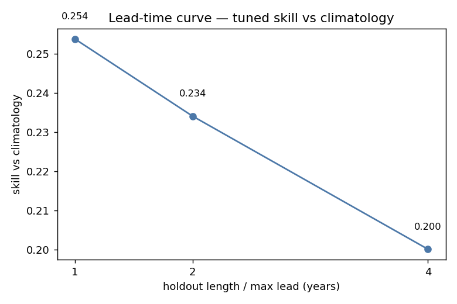
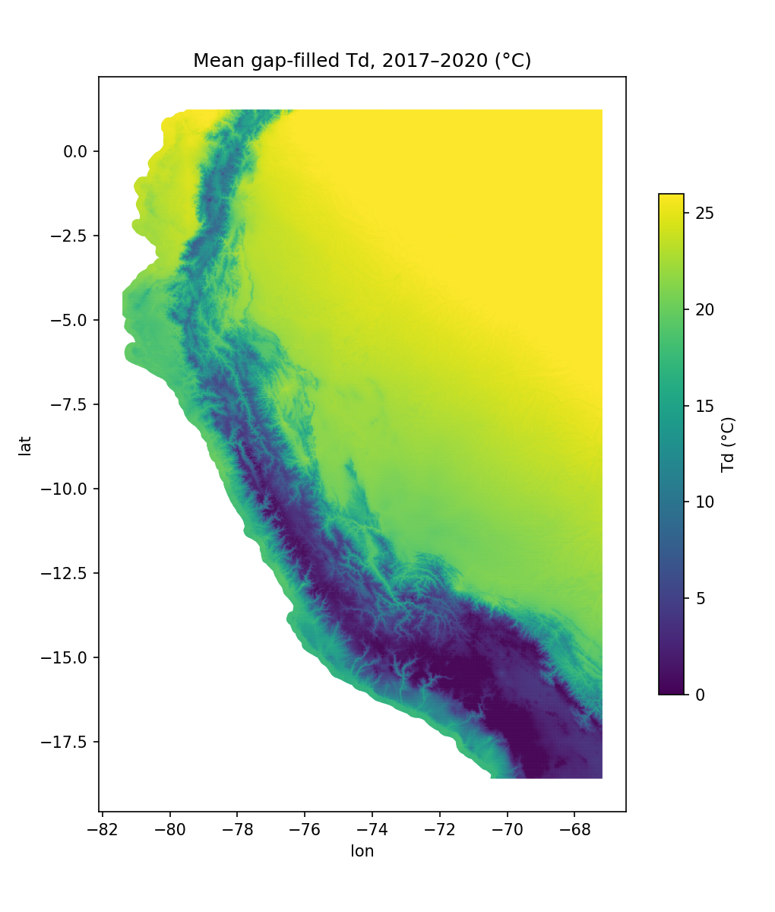

::: {.callout-important}
**DRAFT: not for circulation.** All quantitative results below are AI-assisted analyses that
**require subject-matter-expert (SME) validation before use** (CIP Acceptable Use policy; see
@sec-ai-disclosure and @sec-signoff). Open items are marked **[SME]** or **[TODO]**.
:::

## Abstract {.unnumbered}

The PISCO gridded climate product for Peru provides daily dew-point temperature ($T_d$) through 2016,
while its minimum-temperature ($T_{\min}$) record extends to 2020, leaving a four-year gap in a
variable required for reference-evapotranspiration, disease-risk and crop models. We reconstruct
$T_d$ for 2017–2020 by learning the $T_{\min} \rightarrow T_d$ mapping on the 1981–2016 overlap and
applying it forward at every grid cell. The model is a per-(cell, day-of-year) weighted local linear
regression on climate anomalies; the predictor subset and the day-of-year smoothing half-window $h$
are selected jointly for each combination of SENAMHI climate zone and day of year by
leave-one-year-out cross-validation. Because no observed $T_d$ exists in the gap, reconstruction is
autoregressive: each predicted day supplies the $T_d$ lags of subsequent days.

Because the task is extrapolation in time rather than interpolation in space, we validate by
withholding the four most recent years (train 1981–2012, reconstruct 2013–2016) and scoring against
observed $T_d$ under the same autoregressive conditions the real gap imposes. The model attains
$\mathrm{RMSE} = 1.228$ °C against $1.535$ °C for daily climatology, the incumbent choice for
gap filling: a reduction of $0.307$ °C (95% CI $[0.306, 0.309]$), skill score $0.200$, improving on
climatology at 99.99% of grid cells (Cohen's $d = 2.93$, permutation $p \approx 2 \times 10^{-4}$).
It also improves on $T_d = T_{\min}$ (FAO-56) by $2.32$ °C and on a per-zone ordinary least-squares
fit by $1.10$ °C. Predictors and bandwidths are selected on the training years alone; allowing
selection to see the withheld years would inflate the skill score by $0.009$, which bounds the
optimism such leakage introduces.

The reconstruction covers $2{,}178{,}827$ grid cells over $1{,}461$ days ($3.18 \times 10^{9}$
values) and introduces no discontinuity at the 2016/2017 boundary: over equal-length four-year
windows it differs from the last observed window (mean $-0.041$ °C, sd $0.176$ °C) by no more than
two observed windows differ from each other (mean $+0.101$ °C, sd $0.125$ °C), with no cell
exceeding $1$ °C in either comparison. The principal limitation is a small warm tail (0.13% of
values above 35 °C) confined to the humid-rainforest zone of the north-eastern lowlands and to
November, which we attribute to variance inflation where selection shrinks the smoothing window at
the dry-to-wet transition. **[SME]**

## Introduction

Dew-point temperature is a primary input to reference-evapotranspiration, plant-disease-risk and
crop-growth models. For Peru the PISCO family of gridded products [@huerta2022] supplies the
national daily fields these applications require. The components are released asynchronously:
dew point is available for **1981–2016**, whereas minimum temperature extends to **2020**.
Applications needing $T_d$ after 2016 therefore face a four-year gap.

The available substitutes are unsatisfactory. Daily climatology discards all interannual and
synoptic variability. The FAO-56 approximation $T_d \approx T_{\min}$ [@allen1998] is convenient,
but its bias in arid and high-elevation terrain is well documented and has motivated several
corrections [@kimball1997; @eccel2012]. A single national regression of $T_d$ on $T_{\min}$ ignores
the heterogeneity of Peruvian climate, which spans hyper-arid coast, high Andes and humid Amazon
within a few hundred kilometres.

We therefore ask whether the $T_{\min} \rightarrow T_d$ relationship learned on the 1981–2016
overlap reconstructs $T_d$ for 2017–2020 more accurately than these incumbents. Two properties
distinguish the problem from conventional spatial interpolation and shape the design that follows.
First, it predicts **new years at the same grid cells** rather than new locations, so validation
must withhold years, not sites. Second, **no observed $T_d$ exists anywhere in the target period**;
since $T_d$ lags enter as predictors, reconstruction is necessarily autoregressive, and any honest
validation must be run the same way.

Our contributions are: a reconstruction method in which both the predictor set and the temporal
smoothing bandwidth adapt to climate zone and season; a validation design appropriate to temporal
extrapolation, reported with effect sizes rather than significance alone; the resulting gap-filled
field for 2017–2020; and a characterisation of the conditions under which the method fails.

## Data {#sec-data}

| Quantity | Source | Coverage | Role |
|:---|:---|:---|:---|
| Dew-point temperature $T_d$ | PISCO v1.1 | 1981–2016 | Target |
| Minimum temperature $T_{\min}$ | PISCO v1.2 | 1981–2020 | Predictor |
| Grid | PISCO national grid | 2,818,404 cells | Domain |
| Climate zones | SENAMHI Thornthwaite classification | 41 zones | Unit of model selection |

: Data used in this study. {#tbl-data}

The gridded fields derive from land-surface temperature and elevation covariates by regression
kriging within the PISCOeo_pm framework [@huerta2022]; $T_d$ is not derived from $T_{\min}$
directly, although the two share covariates. Of the 2,818,404 grid cells, **2,178,827** (77.3%)
yield reconstructions; the remainder are ocean or lack the climatology or predictor coverage the
model requires.

**Predictor version.** Minimum temperature exists in two PISCO releases, v1.1 (1981–2016) and v1.2
(1981–2020). As predictors of dew point the two are of comparable quality: fitting and scoring an
identical configuration on each gives RMSE $1.127$ °C against $1.136$ °C, a difference of $0.009$ °C
(@sec-supp-version). They nevertheless yield different fitted models, the mean contemporaneous
$T_{\min}$ coefficient being $0.452$ against $0.370$ with a paired correlation of $0.685$.

Only v1.2 spans the target period, so the reconstruction must use it. We therefore also fit on
**v1.2**, so that the coefficients correspond to the release actually supplied at prediction time.
Fitting on one release and predicting with the other would apply a sensitivity estimated for one
product to another whose fitted sensitivity differs appreciably; we avoid that mismatch by
construction rather than quantify it. Since the two releases are of comparable accuracy, this choice
costs nothing.

**Validation target.** The model is scored against the gridded v1.1 $T_d$, which is the record being
extended and therefore the appropriate reference. The reconstruction consequently inherits any bias
of that product; station-level evaluation is outside the present scope (@sec-limitations).

## Methods {#sec-methods}

### Anomaly formulation

Let $T^{d}_i(t)$ and $T^{\min}_i(t)$ denote dew-point and minimum temperature at grid cell $i$ on
day $t$, and let $d(t) \in \{1, \dots, D\}$ with $D = 366$ be the day of year. For each cell and day
of year we form a climatological mean over the training years $\mathcal{Y}$,

$$
\bar{X}_i(d) \;=\; \frac{1}{|\{t \in \mathcal{Y} : d(t) = d\}|} \sum_{t \in \mathcal{Y},\, d(t) = d} X_i(t),
$$

and model anomalies

$$
X'_i(t) \;=\; X_i(t) - \bar{X}_i\big(d(t)\big).
$$

All fitting and prediction operate on anomalies; the climatology is added back at the end. The
climatology is always computed from training years only, so it leaks no information from a
withheld period.

### Local regression with a day-of-year kernel

For cell $i$ and day of year $d$ the response is the dew-point anomaly $y_i(t) = T^{d\prime}_i(t)$
and the candidate predictors are

$$
\mathcal{P} \;=\; \big\{\,1,\; T^{\min\prime},\; T^{\min\prime}_{-1},\; T^{\min\prime}_{-2},\;
T^{\min\prime}_{-7},\; T^{\min\prime}_{-30},\;
T^{d\prime}_{-1},\; T^{d\prime}_{-2},\; T^{d\prime}_{-3},\; T^{d\prime}_{-7},\; T^{d\prime}_{-30}\,\big\},
$$

where $X_{-\ell}(t) = X(t-\ell)$ and lagged anomalies are formed at the lag day's own day of year.
Dew point enters only through lags, never contemporaneously, since it is unobserved in the target
period. Writing $\mathbf{x}(t)$ for the vector of predictors retained for this zone and day of year,
the model is linear in the anomalies,

$$
y_i(t) \;=\; \mathbf{x}(t)^{\top}\boldsymbol{\beta}_{i,d} \;+\; \varepsilon_i(t).
$$

Observations are weighted by their circular distance in day of year from $d$. With

$$
\delta(a,b) \;=\; \min\big(|a-b|,\; D - |a-b|\big)
$$

and a tricube kernel of half-window $h$,

$$
w_h(\delta) \;=\; \left[1 - \left(\frac{\delta}{h}\right)^{3}\right]^{3} \mathbf{1}\{\delta \le h\},
$$

the coefficients solve a weighted least-squares problem over all training years simultaneously,

$$
\hat{\boldsymbol{\beta}}_{i,d} \;=\; \arg\min_{\boldsymbol{\beta}} \sum_{t}
w_h\big(\delta(d(t), d)\big)\,\big(y_i(t) - \mathbf{x}(t)^{\top}\boldsymbol{\beta}\big)^{2}
\;=\; \big(\mathbf{X}^{\top}\mathbf{W}\mathbf{X}\big)^{-1}\mathbf{X}^{\top}\mathbf{W}\mathbf{y},
$$

with $\mathbf{W} = \operatorname{diag}\{w_h(\delta(d(t), d))\}$. Each (cell, day-of-year) model
therefore borrows strength from neighbouring days of year across all training years, with $h$
controlling how much.

### Selection of predictors and bandwidth {#sec-selection}

Rather than fixing $\mathcal{S} \subseteq \mathcal{P}$ and $h$ globally, we select both for each
combination of climate zone $z$ and day of year $d$, following the multitask design of @hwang2019:
predictors are chosen jointly across the grid cells of a zone while coefficients remain per cell.
The approach has since been benchmarked against other machine-learning methods for subseasonal
forecasting [@he2020] and applied to precipitation [@wang2021]; here it is adapted to a
reconstruction rather than a forecasting task.

The selection objective is leave-one-year-out cross-validated cosine similarity on anomalies. For a
withheld year $u$, coefficients $\hat{\boldsymbol{\beta}}^{(-u)}$ are obtained by excluding that
year, and with $\cos(\mathbf{a}, \mathbf{b}) = \mathbf{a}^{\top}\mathbf{b} / (\lVert\mathbf{a}\rVert
\lVert\mathbf{b}\rVert)$ the criterion is

$$
\mathcal{L}(\mathcal{S}, h) \;=\; \frac{1}{|\mathcal{Y}|}\sum_{u \in \mathcal{Y}}
\cos\Big(\mathbf{y}^{(u)},\; \mathbf{X}^{(u)}\hat{\boldsymbol{\beta}}^{(-u)}_{\mathcal{S},h}\Big).
$$

Because the weighted normal equations are additive over years, the leave-one-year-out fit is
obtained by subtraction, $\mathbf{A}^{(-u)} = \mathbf{A} - \mathbf{A}^{(u)}$, rather than by
refitting; the cross-validation is therefore exact at the cost of a single pass.

Predictors are eliminated by backward stepwise search: starting from the full pool, the predictor
whose removal most improves $\mathcal{L}$ is dropped, and elimination stops when no removal improves
$\mathcal{L}$ by more than a tolerance $\tau$. The search is repeated for each
$h \in \{7, 11, 15, 21, 31, 45\}$ and the pair $(\mathcal{S}, h)$ maximising $\mathcal{L}$ is
retained, giving $41 \times 366 = 15{,}006$ selected models.

Selection uses a stratified sample of 66,534 cells (up to 2,000 per zone). Because the cosine sums
are additive across cells, a sample suffices to choose $(\mathcal{S}, h)$; coefficients are
subsequently fitted at every cell of the domain.

### Autoregressive reconstruction {#sec-forecast}

Let $t_0$ be the last day with observed $T_d$ (31 December 2016). For $t > t_0$ the reconstruction
proceeds forward in time,

$$
\hat{y}_i(t) \;=\; \mathbf{x}(t)^{\top}\hat{\boldsymbol{\beta}}_{i,d(t)},
\qquad
\hat{T}^{d}_i(t) \;=\; \hat{y}_i(t) + \bar{T}^{d}_i\big(d(t)\big),
$$

where the dew-point lag entries of $\mathbf{x}(t)$ are taken from observations before the boundary
and from the model's own output after it,

$$
\big[\mathbf{x}(t)\big]_{T^{d\prime}_{-\ell}} \;=\;
\begin{cases}
y_i(t-\ell), & t-\ell \le t_0,\\[2pt]
\hat{y}_i(t-\ell), & t-\ell > t_0 .
\end{cases}
$$

Minimum-temperature predictors are exogenous and observed throughout, so they never recurse. The
recursion is sequential in time but independent across cells.

### Validation design {#sec-validation}

The quantity of interest is the accuracy of a four-year forward reconstruction, which cannot be
observed directly. We therefore reproduce its conditions on years that can be scored: the model is
fitted on early years and reconstructs the most recent ones, which are withheld. The primary split
withholds four years (fit 1981–2012, reconstruct 2013–2016), matching the length of the real gap;
splits withholding one and two years give the dependence on lead time. Reconstruction of the
withheld block is fully autoregressive, and the climatology is recomputed from training years only.

Spatial cross-validation, the prevailing strategy for gridded products [@kilibarda2014], is not
informative here: withholding locations while retaining contemporaneous observations does not
reproduce a setting in which the target is unobserved everywhere.

Four methods are scored on the identical withheld block:

1. **Daily climatology**, $\hat{T}^d_i(t) = \bar{T}^d_i(d(t))$, equivalent to predicting zero anomaly;
2. **$T_d = T_{\min}$**, the FAO-56 approximation [@allen1998];
3. **Per-zone ordinary least squares** of $T_d$ on $T_{\min}$;
4. **The selected model** of @sec-selection.

We report root-mean-square error, mean absolute error, bias and correlation, and the skill score
relative to climatology,

$$
\mathrm{SS} \;=\; 1 - \frac{\mathrm{RMSE}_{\text{model}}}{\mathrm{RMSE}_{\text{climatology}}} .
$$

Differences are summarised by effect size rather than significance alone: the paired per-cell
difference in RMSE with 95% confidence intervals from a location-block bootstrap, the fraction of
cells improved, Cohen's $d = \bar{\Delta}/s_{\Delta}$ on the paired differences, and a sign-flip
permutation null with 5,000 draws. Scoring uses 17,027 cells distributed across all 41 zones.

Model selection itself can inflate the result, through two distinct routes. If the selection score
is computed over all fitting years, recipes chosen on the full 1981–2016 period have already been
exposed to the years that are later withheld for scoring. Independently, choosing the best of many
candidate recipes favours those whose score is high partly by chance, so the winning score exceeds
the model's true skill even when each individual score is unbiased.

Selection is therefore restricted to the training years in every result reported below: predictors
and bandwidth are chosen on 1981–2012 alone, and the withheld period is never seen at any stage. To
measure the first route we additionally run selection over all years on a common candidate grid;
the difference between the two runs bounds the inflation that such leakage introduces
(@sec-results-validation).

## Results {#sec-results}

### Selected models {#sec-results-selection}

Selection retains most of the candidate pool: the full eleven-predictor set is kept for 70.7% of
zone-days and no predictor is retained in fewer than 91% of models (@fig-selection c), indicating
that the conventional five-predictor configuration is under-specified. The contemporaneous
$T_{\min}$ anomaly is retained almost everywhere, as physical reasoning requires.

The selected bandwidth is broad: $h = 45$ days is modal at 43.1%, with the remainder spread across
the smaller values (@fig-selection a). Wide windows are preferred because the
$T_{\min} \rightarrow T_d$ relationship varies smoothly with day of year, so pooling neighbouring
days buys sample size at little cost in bias. The preference is not uniform across the domain
(@fig-selection b), and the between-zone variation proves consequential (@sec-results-tail).

Cross-validated skill exceeds the fixed five-predictor configuration by $+0.015$ on average (median
$+0.008$), with no gain for 16.8% of zone-days (@fig-selection d). These are in-sample quantities
computed on the same objective that selection maximises; the out-of-sample assessment follows.

{#fig-selection}

### Accuracy on withheld years {#sec-results-validation}

The selected model outperforms every incumbent at every lead time (@tbl-ladder, @fig-ladder).
Against climatology it reduces RMSE by 25% at a one-year lead and by 20% at four years; against the
FAO-56 approximation the reduction exceeds 2.3 °C throughout.

| Withheld period | Climatology | $T_d = T_{\min}$ | Zone OLS | **Selected model** | Skill score |
|:---|---:|---:|---:|---:|---:|
| 2016 (1 year) | 1.680 | 3.621 | 2.378 | **1.254** | 0.254 |
| 2015–2016 (2 years) | 1.667 | 3.676 | 2.369 | **1.276** | 0.234 |
| 2013–2016 (4 years) | 1.535 | 3.551 | 2.328 | **1.228** | 0.200 |

: Root-mean-square error (°C) on withheld years, pooled over all scored cell-days
($n = 24{,}876{,}447$ for the four-year split). The skill score is relative to climatology.
{#tbl-ladder}

Whereas @tbl-ladder compares aggregate error, @tbl-effects asks whether the advantage is large,
uniform across space, and distinguishable from chance. It is: the improvement over climatology has
a tight confidence interval, holds at essentially every cell, and corresponds to a large effect
size.

| Comparison | $\Delta$RMSE (°C) | 95% CI | Skill | Cells improved | Cohen's $d$ | $p$ |
|:---|---:|:---:|---:|---:|---:|---:|
| vs climatology | $+0.307$ | $[0.306, 0.309]$ | 0.200 | 99.99% | 2.93 | $2\times10^{-4}$ |
| vs $T_d = T_{\min}$ | $+2.323$ | $[2.300, 2.345]$ | 0.654 | 99.98% | 1.37 | $2\times10^{-4}$ |
| vs zone OLS | $+1.101$ | $[1.082, 1.118]$ | 0.473 | 99.78% | 1.05 | $2\times10^{-4}$ |

: Paired effect sizes on the four-year withheld block ($17{,}027$ cells). $\Delta$RMSE is the
per-cell reduction in error achieved by the selected model; intervals are from a location-block
bootstrap and $p$ from a sign-flip permutation null. {#tbl-effects}

The selected model has bias $-0.033$ °C and correlation $0.990$. Skill declines monotonically with
lead time ($0.254 \rightarrow 0.234 \rightarrow 0.200$), the expected growth of error under
autoregression, without collapsing over four years (@fig-leadtime).

Predictor and bandwidth selection uses the training years only, everywhere in this paper. To
measure what that restriction costs, we repeated the four-year experiment on a common candidate
grid $h \in \{7, 11, 15, 21\}$, once with selection confined to 1981–2012 and once with selection
allowed to see 2013–2016 as well. Skill rises from $0.197$ to $0.206$ when the withheld years are
visible, so leakage of this kind inflates skill by $0.009$, about $0.013$ °C in RMSE, or 4% of the
improvement over climatology. The bias is small but comparable to the differences between design
choices reported here, which is why the restriction is enforced rather than assumed harmless.
Widening the candidate grid to $h \in \{7, 11, 15, 21, 31, 45\}$ under the same leak-free protocol
recovers $0.003$ of skill ($0.197 \rightarrow 0.200$); that configuration is the one reported
throughout.

**Corrected forms of the FAO-56 baseline.** Established practice applies an offset to
$T_d = T_{\min}$ in arid and semi-arid regions [@kimball1997; @eccel2012; @huang2024]. That
correction does not transfer to this domain (@tbl-fao). The gridded $T_d$ lies systematically
*above* $T_{\min}$ here (bias $-2.13$ °C), which is the opposite of the regime the offset addresses,
so subtracting 2 °C increases the error in every Thornthwaite moisture class, including the
semi-arid and arid classes for which it was devised: RMSE rises from $2.634$ to $3.760$ °C in class
D and from $2.089$ to $2.797$ °C in class E. Scanning the offset continuously, the best-fitting
single value is $+2.25$ °C, of opposite sign to the convention, and yields RMSE $2.847$ °C. Even
that optimal member of the offset family remains far behind the selected model.

| Baseline variant | RMSE | MAE | Bias |
|:---|---:|---:|---:|
| $T_d = T_{\min}$ (uncorrected) | 3.551 | 2.735 | $-2.126$ |
| $T_{\min} - 2$ °C in arid and semi-arid classes | 3.633 | 2.854 | $-2.367$ |
| $T_{\min} - 2$ °C everywhere | 5.011 | 4.263 | $-4.126$ |
| $T_{\min} + 2.25$ °C (best single offset) | 2.847 | | |
| *Selected model, for reference* | *1.228* | *0.881* | *$-0.033$* |

: Corrected forms of the FAO-56 baseline, scored on the identical withheld observations
($n = 24{,}876{,}447$). The conventional arid-region offset increases error over this domain.
{#tbl-fao}

Seasonal bias is also reduced. The fixed configuration carries a December warm bias of $+1.45$ °C
(@sec-supp-version); under per-zone, per-day-of-year selection the December bias falls to
$+0.02$ °C, with all months within $\pm 0.41$ °C.

{#fig-ladder}

{#fig-leadtime}

### The reconstructed field {#sec-results-product}

Applying coefficients fitted on 1981–2016 to the observed 2017–2020 minimum temperature yields
$3{,}183{,}266{,}247$ values with no missing entries. National mean $T_d$ is $19.39$ °C (range
$-13.29$ to $41.16$ °C) and annual means are stable across the period ($19.36$, $19.30$, $19.41$ and
$19.51$ °C), showing no drift under sustained autoregression.

The field reproduces the expected national structure, with a humid Amazon near 25 °C, a sharply
delineated cold Andean cordillera and the coastal gradient (@fig-map), and continues the observed
seasonal cycle across the 2016/2017 boundary with matching amplitude and phase (@fig-timeseries).

{#fig-timeseries}

{#fig-map}

### Continuity at the record boundary {#sec-results-seam}

A reconstruction appended to an observed record must not introduce an artificial step. Comparing
adjacent months across the boundary would confound such a step with the seasonal cycle, so we
compare equal-length full-year windows, which removes seasonality, and include a model-free control:
the difference between two consecutive observed four-year windows, which measures the
period-to-period variability of the observed record itself.

| Comparison | Mean | sd | 1st–99th pct | Cells $\lvert\Delta\rvert > 1$ °C |
|:---|---:|---:|:---:|---:|
| Observed 2013–16 $-$ observed 2009–12 (control) | $+0.101$ | 0.125 | $-0.18$ … $+0.42$ | 0.0% |
| Reconstructed 2017–20 $-$ observed 2013–16 | $-0.041$ | 0.176 | $-0.36$ … $+0.54$ | 0.0% |

: Difference in annual-mean dew point (°C) between four-year windows, over $2{,}178{,}827$ cells.
The first row involves no model and quantifies natural variability. {#tbl-seam}

The reconstruction differs from the last observed window by no more than two observed windows differ
from each other: its spread is 1.4 times the control, its mean is closer to zero, and no cell in
either comparison differs by more than 1 °C (@fig-seam). The difference field is spatially smooth
and coherent, without the blockiness or speckle a numerical artefact would produce.

{#fig-seam}

### Extreme values {#sec-results-tail}

A small fraction of reconstructed values is physically implausible: 0.1326% exceed 35 °C, with a
maximum of 41.16 °C. These values are sharply localised in space, time and season, and their
structure identifies their origin.

They occur exclusively in one climate zone, the Thornthwaite class `A (r) A'` (perhumid, no water
deficiency, megathermal) of the north-eastern lowlands, affecting $132{,}920$ of that zone's
$909{,}708$ cells. In time they are concentrated almost entirely in **November**: pooled over
2017–2020, 1.556% of November values exceed the threshold against 0.027% in October, and only 50
exceedances occur in total between January and July (@fig-tail-month).

The concentration is not explained by accumulation of autoregressive error. Annual incidence is
non-monotonic (0.2015%, 0.1696%, 0.0293% and 0.1299% for 2017–2020) and exceedances occur in short
episodes, 40.6% of them isolated single days, with a mean run of 3.42 days. Progressive error growth
of the kind reported for free-running autoregressive models [@gallusser2025] would produce
lengthening runs and monotonic growth with lead time; neither is present.

Nor is it a failure of average fit. In the affected zone, November cross-validated skill ($0.7317$)
is indistinguishable from December ($0.7333$) and January–July ($0.7324$), and higher than
August–September ($0.7030$); in-sample $R^{2}$ behaves likewise. The failure affects the tail of the
predictive distribution rather than its centre, consistent with annual means remaining stable to
$0.21$ °C.

The determining observation concerns the selected bandwidth. Although $h = 45$ is modal nationally,
this zone prefers narrower windows (median $h = 21$, 31.7% at $h = 45$), and **November is its
narrowest band**: 47% of November days select $h \le 11$ against 23% in October, with median
$h = 15$ in November against $31$ in both adjacent months. Selection responds to a rapidly changing
time of year by shrinking the window, trading bias for variance. Since the quantity measured is an
exceedance rate above a fixed threshold, variance rather than bias governs it: a modest increase in
predictive spread, invisible in mean skill, moves the exceedance rate by a factor of 58. Confining
narrow windows to the transition band also confines the inflated variance there, which accounts for
the concentration in a single month.

The exceedance peak moves between years, at day of year 313 in 2017, 331 in 2018, 313 in 2019 and
331 in 2020, with the distribution mean shifting between days 314.9 and 322.2.

{#fig-tail-month}

{#fig-tail-panel}

## Discussion {#sec-discussion}

### Estimating humidity from temperature

The FAO-56 identity $T_d \approx T_{\min}$ [@allen1998] is a starting point rather than the state of
the art. Its bias in arid, semi-arid and high-elevation terrain is documented and several
corrections are in routine use: an aridity-dependent adjustment driven by precipitation and
potential evapotranspiration [@kimball1997], a correction from temperature and precipitation
validated at alpine stations [@eccel2012], and a $-2$ °C offset widely applied in arid regions
[@huang2024]. Disaggregation frameworks implement both the identity and fitted alternatives
precisely because it fails in a site- and regime-specific way [@forster2016]. Those corrections are
nonetheless regime-specific themselves: over the present domain the conventional arid-region offset
increases error in every moisture class, and the best-fitting offset has the opposite sign
(@tbl-fao). Reported corrections should not be transferred between products and regions without
re-estimation.

The most directly comparable result is that of @althoff2022, who calibrate a temperature-based
approach over the Brazilian Cerrado, a tropical biome with a pronounced dry season, and obtain
corrections of **opposite sign in the two seasons**: $-0.93$ °C in the wet season ($T_d > T_{\min}$)
against $+0.57$ °C in the dry season ($T_d < T_{\min}$). The coupling is thus not a fixed offset but
a regime-dependent relationship. Selecting a separate model for each climate zone and day of year
generalises that observation, and the magnitude of the improvement over both $T_d = T_{\min}$
($+2.33$ °C) and a per-zone linear fit ($+1.11$ °C) is consistent with it: a single global or even
per-zone linear relationship is too rigid for this domain.

### Interpretation of the selected bandwidths

The preference for wide day-of-year windows has an independent precedent: @chabotcouture2014
interpolate dew point with day-of-year-dependent parameters smoothed over 31-day windows, a
comparable scale. Wide windows are appropriate where the relationship varies smoothly with season.
Where it does not, selection narrows them, and @sec-results-tail shows that this local narrowing,
rather than the national preference for broad pooling, governs the method's failure mode. Bandwidth
selection is therefore not merely a tuning detail: it is the mechanism by which the method adapts
to seasonal structure, and also the mechanism by which it fails when that structure is abrupt.

### Temporal extrapolation and its validation

Work described as gap filling usually reconstructs values missing *inside* an existing record,
using surrounding observations in space and time [e.g. @serranonotivoli2019]. The present problem
differs in kind: the target is unobserved everywhere throughout the period to be filled. The
methodological consequence is that spatial cross-validation, which withholds locations while
retaining contemporaneous observations [@kilibarda2014], cannot measure the quantity of interest,
and only a forward temporal hold-out reproduces the operational setting. Systematic reporting of
incumbent baselines and effect sizes is likewise uncommon in this literature, and we regard the
validation design as part of the contribution rather than as supporting material.

### Stability of long autoregressive reconstruction

Because dew-point lags are predictors and no observation exists in the target period, the
reconstruction is a 1,461-step recursion. The deep-learning climate literature documents that such
rollouts can degrade progressively or diverge through error accumulation, and that explicit
multi-step training is needed to stabilise them [@gallusser2025]. No comparable degradation appears
here: skill decays gracefully with lead time, annual means are stable to $0.21$ °C over four years,
and the incidence of extreme values is non-monotonic in time rather than growing.

Two properties of the formulation account for this. The dominant predictors are anomalies of
observed, exogenous $T_{\min}$, supplied from data at every step and never recursed; only the
dew-point lag channel is autoregressive. And predictions are formed as anomalies added to a fixed
per-cell climatology, which anchors the recursion to a physically sensible level. Emulators that
must propagate their entire state forward have neither property. This suggests that hybrid
recursions combining observed exogenous forcing with a climatological anchor are substantially more
stable over long horizons than fully autoregressive ones, and that stability concerns from that
literature do not transfer directly to this class of model.

### Origin of the November extremes

The dry-to-wet transition in Amazonia is a rapid regime shift rather than a gradual seasonal
progression: it is initiated by late-dry-season rainforest transpiration activating shallow
convection [@wright2017], driven by increases in surface latent heat flux that rapidly reduce
convective inhibition [@fu2004], accompanied by a reorganisation of the large-scale circulation
[@li2004], and is routinely dated to a specific pentad [@marengo2017]. Its timing varies between
years, modulated non-linearly by Pacific and Atlantic sea-surface temperatures and by the
Madden–Julian Oscillation [@yin2014; @marengo2017], which is consistent with the observed movement
of the exceedance peak and with the sevenfold range in its severity.

An abrupt transition is also the classical setting in which nonparametric smoothing struggles, since
such methods require the underlying function to be smooth and jumps must be handled explicitly
[@zhang2016]. The behaviour documented here is a specific instance: rather than biasing the fit,
the abrupt transition drives the selection criterion to a narrow bandwidth, and the resulting
variance inflation appears in the tail of the reconstruction.

The artefact class is not new. @chabotcouture2014 report interpolated dew point exceeding
interpolated air temperature, implying relative humidity above 100%, in a day-of-year-parameterised
dew-point interpolation, and recommend capping. The regime is additionally non-stationary, which
compounds the difficulty of estimating it from a 1981–2016 sample: dry-season vapour pressure
deficit over the Amazon has been rising [@mu2025] and vertical drying has been observed over
deforested Amazonia [@hierro2025].

## Limitations {#sec-limitations}

**Extreme values.** The warm tail characterised in @sec-results-tail is not corrected in the
released field. The diagnosis implies a targeted remedy at the point of fitting, namely constraining
the minimum bandwidth or otherwise regularising the fits for the transition band in the affected
zone; this is untested. **[TODO]**

A post-hoc bound is also available, and the appropriate form is a bound on the *excess* over
same-day minimum temperature rather than on $T_{\min}$ itself. Capping at $T_d \le T_{\min}$ is not
viable, because 79.6% of reconstructed values exceed same-day $T_{\min}$ by a mean of $3.0$ °C, as
does the observed gridded $T_d$; such a cap would alter most of the field by a mean of $2.38$ °C.
The exceedances are extreme on this measure too, exceeding same-day $T_{\min}$ by $11.4$ °C against
a typical $3.0$ °C, and are therefore separable from the bulk of the distribution (@tbl-bound). A
bound of $T_d \le T_{\min} + 8$ °C removes 99.1% of them while altering 2.2% of values by a mean of
$0.030$ °C over the field, three orders of magnitude less perturbation than a cap at $T_{\min}$.
Whether to apply such a bound to the released field is a judgement about whether a small targeted
perturbation is preferable to retaining known-implausible values. **[SME]**

| Bound | Values altered | Mean shift over all values (°C) | Exceedances removed |
|:---|---:|---:|---:|
| $T_d \le T_{\min}$ | 79.6% | 2.38 | 100% |
| $T_d \le T_{\min} + 5$ | 13.31% | 0.222 | 100.0% |
| $T_d \le T_{\min} + 6$ | 7.67% | 0.120 | 99.98% |
| $T_d \le T_{\min} + 8$ | 2.23% | 0.030 | 99.07% |
| $T_d \le T_{\min} + 10$ | 0.54% | 0.006 | 89.60% |
| $T_d \le T_{\min} + 12$ | 0.09% | 0.0007 | 30.83% |

: Effect of bounding the dew-point excess over same-day minimum temperature, evaluated over all
$3.18 \times 10^{9}$ reconstructed values. {#tbl-bound}

That November corresponds to the dry-to-wet transition in this region requires confirmation against
regional climatology. **[SME: confirm regional seasonality]**

**Attribution of the boundary signal.** The reconstructed-minus-observed field in @fig-seam carries
a coherent regional pattern. Because no observed $T_d$ exists after 2016, that comparison alone
cannot separate a genuine 2017–2020 climate anomaly from regional model bias; the bound comes from
@sec-results-validation, where regional errors are measured on withheld years. **[SME]**

**Shared covariates.** Gridded $T_d$ and $T_{\min}$ share land-surface-temperature and elevation
predictors in their construction, so validation against gridded $T_d$ may flatter the mapping
relative to an independent reference.

**No station-level evaluation.** The target is the gridded product being extended, which is the
correct reference for this task, but the reconstruction inherits that product's biases.
Station-level evaluation is the natural next step. **[TODO]**

**Baseline correction.** The FAO-56 baseline is reported in its uncorrected form because, over this
domain, the conventional arid-region offset increases its error whether applied regionally or
globally (@tbl-fao). We have not evaluated the aridity-dependent formulations of @kimball1997 or
@eccel2012, which use precipitation as well as temperature and may behave differently. **[TODO]**

**Lead time.** Skill decays with lead time, so 2020 rests on a longer recursion than 2017. The
lead-time curve quantifies this to four years, the length of the actual gap.

**Non-stationarity.** We did not test the training period for non-stationarity in the
$T_{\min} \rightarrow T_d$ relationship. **[TODO]**

## Supplementary material {#sec-supp}

### Predictor-version sensitivity {#sec-supp-version}

The two PISCO minimum-temperature releases yield different fitted models of comparable accuracy.
Each release was run through the identical pipeline, fitted and scored on itself, over
$7.32 \times 10^{6}$ (cell, day-of-year) fits. The fitted coefficients differ, most clearly in the
contemporaneous sensitivity:

| Coefficient | v1.1 mean | v1.2 mean | Mean $\Delta$ | Mean $\lvert\Delta\rvert$ | Pearson $r$ |
|:---|---:|---:|---:|---:|---:|
| $T_{\min}$ anomaly | 0.452 | 0.370 | $-0.083$ | 0.130 | 0.685 |
| $T_d$ lag 1 | 0.782 | 0.813 | $+0.031$ | 0.047 | 0.925 |
| $T_d$ lag 2 | $-0.019$ | $-0.031$ | $-0.012$ | 0.026 | 0.920 |
| $T_{\min}$ lag 1 | $-0.236$ | $-0.182$ | $+0.054$ | 0.092 | 0.669 |
| $R^{2}$ (anomalies) | 0.787 | 0.778 | $-0.009$ | 0.019 | 0.953 |

: Coefficients fitted on PISCO v1.1 against v1.2 minimum temperature, paired over identical fits.
The contemporaneous sensitivity differs most. {#tbl-supp-coef}

The two self-consistent pipelines agree with one another to $\mathrm{RMSE} = 0.610$ °C
($r = 0.995$) with a mean offset of $-0.300$ °C. Scored against observed dew point they are
nevertheless of comparable accuracy, v1.1 giving marginally lower error and v1.2 being better
centred:

| Predictor version | RMSE | MAE | Bias | Pearson $r$ |
|:---|---:|---:|---:|---:|
| v1.1 | 1.127 | 0.844 | $+0.443$ | 0.982 |
| v1.2 | 1.136 | 0.867 | $+0.143$ | 0.979 |

: Accuracy against observed dew point for each predictor version ($n = 7.3 \times 10^{6}$).
{#tbl-supp-acc}

The accuracy difference between releases, $0.009$ °C, is negligible against the $0.307$ °C
improvement the selected model achieves over climatology: as predictors of dew point the two are
effectively equivalent, and choosing v1.2 costs nothing. What differs is the fitted relationship,
with a paired correlation of only $0.685$ on the contemporaneous term, which is why we fit and
predict on the same release.

Note that the $-0.300$ °C offset above is the difference between two **internally consistent**
pipelines, each fitted and applied to its own release. It is not a measurement of the penalty for
mixing releases, a configuration we did not run; the case for consistency here is that coefficients
should correspond to the predictor actually supplied, not an estimated error bound. **[TODO]**

This fixed five-predictor configuration also carries a December warm bias of $+1.45$ °C, which
per-zone seasonal selection removes (@sec-results-validation).

### Computational characterisation {#sec-supp-compute}

Fitting $2.8 \times 10^{6}$ cells $\times$ 366 days of year is dominated by memory traffic rather
than arithmetic, which determines how the method scales.

On CPUs, parallel efficiency $E(p) = T(1)/(p\,T(p))$ is essentially independent of problem size,
indicating that the limit is memory bandwidth rather than parallel overhead:

| Workers $p$ | $N = 512$ | $N = 1024$ | $N = 2048$ |
|---:|---:|---:|---:|
| 2 | 0.939 | 0.917 | 0.912 |
| 4 | 0.830 | 0.826 | 0.824 |
| 8 | 0.709 | 0.704 | 0.699 |
| 16 | 0.562 | 0.560 | 0.557 |
| 32 | 0.345 | 0.342 | 0.337 |

: Strong-scaling efficiency $E(p)$ for three problem sizes ($N$ = grid cells). Efficiency at fixed
$p$ varies by less than 0.01 across a fourfold change in $N$. {#tbl-supp-cpu}

Weak scaling at constant work per worker gives $E = 1.000$, $0.927$ and $0.846$ at $p = 1, 2, 4$.

On a single GPU the same conclusion follows from a roofline analysis. With measured bandwidth
633 GB s⁻¹ and 4200 GFLOPS double precision, the ridge lies at an arithmetic intensity of
approximately 6.6 FLOP B⁻¹, whereas the pipeline operates between 0.08 and 0.61:

| Stage | Arithmetic intensity (FLOP B⁻¹) | GFLOPS | Regime |
|:---|---:|---:|:---|
| Assemble | 0.114 | 44.7 | memory-bound |
| Convolve | 0.083 | 24.8 | memory-bound |
| Solve | 0.615 | 320 | memory-bound |
| Total | 0.105 | 36.1 | memory-bound |

: Roofline position of each pipeline stage at $N = 512$ cells. All stages lie far below the ridge.
{#tbl-supp-gpu}

Solver throughput reaches $2.09 \times 10^{9}$ fits s⁻¹ at large batch sizes. The practical
consequence is that the implementation is bounded by data movement, so the productive optimisations
are those that reduce traffic, and the full-domain fit remains tractable on a single device.

## Data and code availability {#sec-availability}

The reconstruction covers 2017–2020 at the PISCO national grid. Analysis code implements model
selection, coefficient fitting, autoregressive reconstruction and the validation harness; the
scripts reproducing each figure and reported statistic accompany the manuscript, together with the
retrieved literature records supporting @sec-discussion.

**[TODO]** Deposit the reconstructed field and a frozen code release, and record their identifiers
here.

## AI-use disclosure {#sec-ai-disclosure}

In accordance with CIP's Acceptable Use and Privacy policy: the analysis pipeline, validation
harness, reconstruction driver and figures were developed and executed with AI assistance
(Anthropic Claude, via Claude Code) under the direction and review of the author. The assistant
wrote and ran analysis code, produced the figures, and drafted this manuscript. No confidential,
personal or unpublished third-party data was provided to the assistant; all inputs are institutional
gridded climate products.

All quantitative results are pending SME validation (@sec-signoff). Values were read directly from
the recorded outputs of the runs cited rather than reproduced from memory. Of the works cited, full
text was consulted for eight; the remainder were assessed from abstracts and indexed metadata, and
those supporting @sec-discussion should be verified in full before submission. **[TODO]**

## SME sign-off {#sec-signoff}

| Item | Reviewer | Date | Status |
|:---|:---|:---|:---:|
| Validation design and baselines (@sec-validation) | | | ☐ |
| Withheld-year results and effect sizes (@tbl-ladder, @tbl-effects) | | | ☐ |
| Boundary continuity (@tbl-seam) | | | ☐ |
| Disposition of extreme values (@sec-results-tail) | | | ☐ |
| Regional seasonality of the transition month | | | ☐ |
| Release of the reconstructed field and metadata | | | ☐ |

: Sign-offs required before submission. {#tbl-signoff}

## References {.unnumbered}

::: {#refs}
:::
