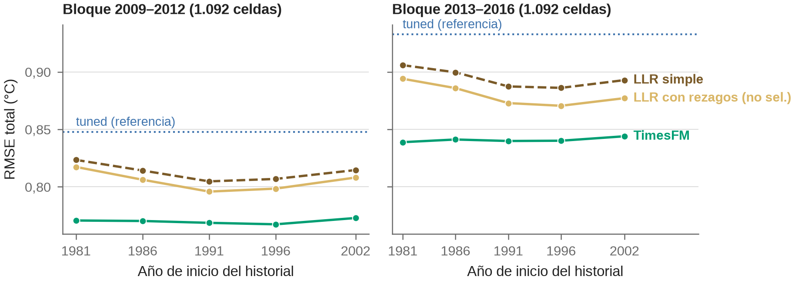
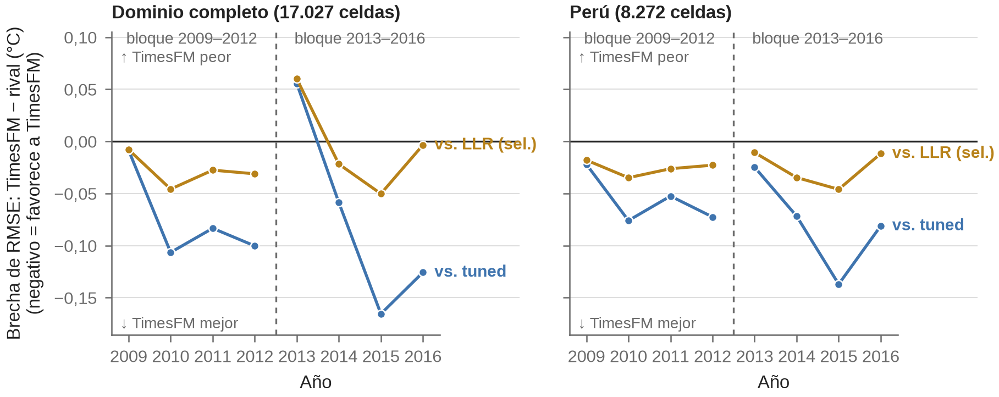

Las tablas rotulan los bloques por sus años de prueba, 2009–2012 y 2013–2016, y los ámbitos como «dominio completo» y «Perú», igual que el cuerpo del artículo. Brecha = RMSE(A) − RMSE(B); un valor negativo favorece a A.

# S1. tuned sin rezagos de Td {#sec-s1}

::: {#tbl-s1}


Brechas de tuned sin rezagos de Td y de TimesFM frente a él, con IC al  % por bloques espaciales de ° y por bloques mes-año.
:::

::: {#tbl-s1-anual}


RMSE anual de tuned y de tuned sin rezagos de Td. La diferencia por año es descriptiva, sin IC.
:::

::: {#tbl-s1-victorias}


Zonas en que tuned sin rezagos de Td tiene menor RMSE que tuned y que el LLR simple, y zonas en que el LLR simple tiene menor RMSE que tuned sin rezagos de Td.
:::

Tuned sin rezagos de Td repite el protocolo de tuned con un pool sin rezagos de Td, de modo que cambian el pool y las recetas y ventanas que la selección elige en consecuencia. Su RMSE es menor que el de tuned en el dominio completo por  °C en 2013–2016 (IC mes-año ) y por  °C en 2009–2012 (IC mes-año , que incluye cero). Por año, su RMSE fue mayor que el de tuned en el dominio completo en  y menor en los demás (@tbl-s1-anual). Fue menor en  de  zonas en 2013–2016 y en  de  en 2009–2012. Frente al LLR simple, la brecha es de  °C en 2013–2016 (IC mes-año ) y de  °C en 2009–2012. La brecha de TimesFM frente a tuned sin rezagos de Td en 2013–2016 con dominio completo es de  °C, con IC mes-año . Las tablas no aíslan qué componente causa la reducción.

# S2. Tmin barajada {#sec-s2}

::: {#tbl-s2}


Corridas del control de Tmin barajada en 2013–2016, en el subconjunto de cribado. «Entre años» y «entre celdas» son los modos de barajado de la Tmin del bloque. «—» indica que el campo no aplica: la climatología y tuned no tienen variante de TimesFM, y las corridas con Tmin observada no tienen modo de barajado.
:::

Con la Tmin alineada, TimesFM en anomalías tuvo un RMSE de  °C, frente a  de tuned y  de la climatología (@fig-s-a3). Con la Tmin barajada entre años, las  corridas ( semillas en la variante en anomalías) quedaron entre  y  °C, todas peores que la climatología. Con el barajado entre celdas, determinista y de una sola realización, el RMSE fue  °C. TimesFM es sensible a que la Tmin esté alineada con el bloque. El control no aísla el aporte de la Td histórica.

{#fig-s-a3 width=100%}

# S3. Escalera de contexto {#sec-s3}

::: {#tbl-s3}


Escalera de inicio del contexto, en el subconjunto de cribado de  celdas (no en las  del dominio completo). La climatología se mantiene en 1981–fin del entrenamiento, salvo en TimesFM con contexto desde 2002, que usa climatología y contexto desde 2002.
:::

::: {#tbl-s3-brechas}


Brechas de RMSE de la escalera de contexto, con IC al  % por bloques espaciales de ° y por bloques mes-año, en el mismo subconjunto de cribado.
:::

Con la climatología fija, recortar el contexto de TimesFM hasta 2002 cambia el RMSE en  °C en 2009–2012 (de  a ) y en  °C en 2013–2016 (de  a ), en las  celdas del subconjunto (@fig-s-escalera). El RMSE del LLR con rezagos cambia  °C en 2009–2012 y  °C en 2013–2016 al iniciar en 1991. Cambiar también la climatología pesa más: el RMSE de TimesFM con contexto desde 2002 cambia  °C en 2009–2012 y  °C en 2013–2016. En el dominio completo ( celdas), esa variante tuvo un RMSE de  °C en 2009–2012 y de  °C en 2013–2016, frente a  y  °C de la referencia. La escalera mide la sensibilidad al inicio del historial y de la climatología; no identifica un quiebre del producto en 2000 ni determina el historial mínimo.

{#fig-s-escalera width=100%}

# S4. Contraste con estaciones ISD y productos 2017–2020 {#sec-s4}

::: {#tbl-s4}


Contraste con estaciones de aeropuerto ISD [@smith2011], por producto, período y métrica. Los conteos de estaciones y días-estación difieren entre métricas. Error = fuente − estación.
:::

::: {#tbl-s4-delta}


Diferencia de RMSE entre TimesFM y tuned (columna «palacios») sobre los mismos días de 2017–2020, con IC al  % por bootstrap de estaciones.
:::

En los bloques se mide cuánto reproduce cada método la Td grillada de PISCO; aquí, cuánto se aproxima cada producto a la Td atmosférica en puntos de aeropuerto. Para PISCO en 2009–2016 hay  estaciones y  días-estación en Td absoluta, y  y  en anomalías; para los dos productos de 2017–2020,  estaciones y  días-estación en ambas métricas. Los tres productos tienen sesgo positivo en Td:  °C para PISCO,  para tuned y  para TimesFM. En 2017–2020, la diferencia de RMSE de TimesFM frente a tuned es de  °C en Td, con IC  que incluye cero, y de  °C en anomalías, con IC  que excluye cero. El acuerdo entre productos no equivale a exactitud, y no se verificó la independencia de las estaciones respecto de PISCO.

# S5. LLR no seleccionados y seleccionados {#sec-s5}

::: {#tbl-s5}


RMSE de cada LLR y brecha de TimesFM frente a él, con IC al  % por bloques espaciales de ° y por bloques mes-año. Brecha = RMSE(TimesFM) − RMSE(LLR); negativa favorece a TimesFM.
:::

La brecha de TimesFM frente a las  LLR sin zonas es negativa en los  casos de cada bloque y ámbito, y su tamaño depende de la variante. En 2009–2012 ambos IC excluyen cero frente a las . En 2013–2016 con dominio completo, la brecha es de  °C frente al LLR simple, de  °C frente al LLR simple seleccionado (IC mes-año ) y de  °C frente al LLR con rezagos seleccionado. El IC mes-año incluye cero frente a las  (excluye cero en ), y el IC espacial excluye cero frente a . Frente a cada variante, los dos IC excluyen cero en  de  combinaciones de bloque y ámbito. La cercanía de las LLR a TimesFM no depende de una sola variante.

# S6. Conteo de zonas con menor RMSE de TimesFM {#sec-s6}

::: {#tbl-s6}


Zonas en que TimesFM tiene menor RMSE que cada rival, con la brecha por zona más y menos negativa frente a tuned. Las brechas por zona son descriptivas, sin IC.
:::

El conteo es un registro secundario que no pondera por celdas ni por magnitud. TimesFM tiene menor RMSE que tuned en  de  zonas en 2009–2012, con brechas entre  y  °C, y en  de  en 2013–2016, con brechas entre  y  °C. Frente al LLR con rezagos seleccionado, tiene menor RMSE en  zonas en 2009–2012 y en  en 2013–2016; la excepción es la zona  ( celdas), con una brecha de  °C.

# S7. Detalle de costo y lista completa de corridas {#sec-s7}

::: {#tbl-s7-detalle}


Tiempo de pared por etapa y método, en 2009–2012 y a escala de producto 2017–2020 (corridas no controladas). Los cocientes son redondeados. La selección de TimesFM se hizo una vez, en 2013–2016, y se suma una sola vez al total. Las filas de las LLR seleccionadas se midieron en una corrida única, en otra máquina y sin GPU (Intel Core i9-14900K), y no son controladas frente a tuned y TimesFM. La tabla de costo del cuerpo resume esta.
:::

::: {#tbl-s7}


Corridas de costo documentadas, con celdas, tiempo de pared, hardware y observaciones. Los tiempos de las LLR corresponden a la versión sin selección conjunta de h y año de inicio. «No registrado» indica que el log de la corrida no consigna el hardware.
:::

La lista incluye corridas que la tabla anterior no usa: la inferencia de TimesFM en Td cruda, las corridas de 2013–2016 de ambos métodos, la pasada de escala de TimesFM y las etapas de las LLR sin selección conjunta. La inferencia de TimesFM en 2009–2012 procesó  celdas por segundo, menos que la pasada de escala (); no se identificó la causa. La corrida de tuned en 2013–2016 es de Palacios y su log no registra el host. Los tiempos de las LLR no se leen junto al RMSE de las versiones seleccionadas, cuyo costo no se midió.

# S8. Insumos de diseño {#sec-s8}

::: {#tbl-s-insumos}


Insumos y decisiones previas de cada método. Las cifras de diseño del cuerpo se calculan con código.
:::

El pool de tuned tiene  términos: la constante, la anomalía de Tmin del día,  rezagos de Tmin ( días) y  rezagos de Td ( días); tuned sin rezagos de Td conserva . Las LLR sin selección conjunta eligen h entre  valores ( a ) con los últimos  años de entrenamiento como validación. Las seleccionadas evalúan  combinaciones de  valores de h ( a ) y  años de inicio ( a ). La grilla de h de tuned proviene de la documentación de costos y no de los valores por defecto del código, por lo que no se calculó como cifra.

# S9. Habilidad frente a climatología, razón de varianzas y correlación {#sec-s9}

::: {#tbl-s9}


Habilidad (1 − MSE/MSE de la climatología), razón de varianzas de la anomalía predicha respecto de la observada y correlación de anomalías, por bloque, ámbito y método.
:::

TimesFM tiene la mayor habilidad, la mayor razón de varianzas y la mayor correlación en los cuatro casos. En el dominio completo de 2009–2012 la habilidad es de  para TimesFM y de  para tuned; en 2013–2016, de  y . La razón de varianzas es menor que uno en todas las filas, y ningún método reproduce la variabilidad de las anomalías observadas. En 2013–2016 con dominio completo, la de TimesFM es  y la de tuned, . Las diferencias son descriptivas, sin IC.

# S10. Error en las colas de la anomalía {#sec-s10}

::: {#tbl-s10}


RMSE y sesgo por clase de la anomalía observada (cola inferior, cuerpo central y cola superior de la distribución de anomalías) y brecha TimesFM − método, por bloque y ámbito.
:::

En la cola cálida (5 % superior) el sesgo de todos los métodos es negativo: subestiman las anomalías positivas. En 2013–2016 con dominio completo, el RMSE de esa clase es de  °C para TimesFM y de  °C para tuned; en la cola fría (5 % inferior), de  y  °C. Las brechas de la cola cálida son mayores en magnitud que las del cuerpo central, y no tienen IC. Las clases se definen por la anomalía observada, es decir, condicionan por el resultado, y eso produce un sesgo de signo por construcción: que todos los métodos subestimen la cola cálida es en parte efecto de esa definición.

# S11. Calibración de los cuantiles de TimesFM {#sec-s11}

::: {#tbl-s11}


Cobertura del intervalo q10–q90, anchura media, CRPS aproximado por cuadratura de los nueve cuantiles y fracción de observaciones bajo q10 y sobre q90, por bloque, ámbito y año. Solo TimesFM entrega cuantiles.
:::

La cobertura nominal del intervalo es  %. En el dominio completo la cobertura total fue de  % en 2009–2012 y de  % en 2013–2016, con una anchura media de  y  °C. Las colas son asimétricas: en 2009–2012 el  % de las observaciones quedó bajo q10 y el  % sobre q90, frente a un  % nominal en cada cola. La cobertura varía por año. Los rivales no tienen salida probabilística y no hay comparación de calibración.

# S12. Brecha por banda de altitud {#sec-s12}

::: {#tbl-s12}


Celdas por banda, RMSE de TimesFM y brecha TimesFM − rival por banda de altitud, bloque y ámbito. Las brechas son descriptivas, sin IC.
:::

Frente a tuned, la brecha es negativa en todas las bandas y mayor en magnitud en la más alta: en Perú y 2009–2012,  °C en esa banda y  °C en la más baja. Frente al LLR con rezagos seleccionado, la brecha de la banda más baja en el dominio completo de 2013–2016 es de  °C, de signo positivo, y en las bandas superiores es negativa. Las celdas por banda son muy desiguales: la más baja reúne  celdas en el dominio completo.

# S13. Brecha por fase ENSO {#sec-s13}

::: {#tbl-s13}


RMSE y sesgo de TimesFM y brecha frente a cada rival por clase ONI (El Niño, La Niña, neutral) y número de meses de cada clase, por bloque y ámbito. La clasificación usa el ONI de NOAA CPC.
:::

Los estratos están desbalanceados: en 2013–2016 hay  meses de El Niño,  neutrales y  de La Niña. La fila de un único mes refleja ese mes y no se interpreta. La fase ENSO no se usa para explicar el resultado de 2013 ni de 2015–2016, y las brechas por clase no tienen IC.

# S14. Contribución de la zona dominante {#sec-s14}

::: {#tbl-s14}


Brecha total, brecha dentro de la zona SENAMHI con más celdas y brecha en el resto de las celdas, por rival, bloque y ámbito, con el porcentaje de celdas de la zona.
:::

La zona A(r)A' reúne el  % de las celdas del dominio completo ( % en Perú) y aporta el  % del error cuadrático de TimesFM en 2009–2012. Frente a tuned, la brecha en 2013–2016 con dominio completo es de  °C en total,  °C dentro de la zona y  °C en el resto. Frente al LLR con rezagos seleccionado es de  °C dentro de la zona, donde TimesFM no mejora, y de  °C en el resto. La descomposición es descriptiva, sin IC.

# S15. Detalle de la inferencia {#sec-s15}

Los IC se obtuvieron con cuatro esquemas de bootstrap por bloques, pareados y con las mismas réplicas para todas las parejas. El esquema espacial usa cuadrículas de ° ( bloques en el dominio completo y  en Perú) y conserva la serie temporal de cada celda. El esquema mes-año ( bloques) conserva la dependencia espacial dentro del mes. El esquema espacio-tiempo usa una cuadrícula de ° durante un año ( bloques en el dominio completo y  en Perú) y rompe la dependencia entre años de una misma cuadrícula. El esquema trimestre-año ( bloques) es solo temporal: conserva la dependencia espacial completa y, con pocos bloques, produce los IC más anchos. La prueba de Diebold–Mariano usa la serie diaria del diferencial de error cuadrático promediado entre celdas, varianza de Newey–West con núcleo de Bartlett, corrección de Harvey–Leybourne–Newbold para horizonte uno, p-valores de una t con T − 1 grados de libertad y ajuste de Holm sobre  pruebas, por separado para cada rezago ( y  días). Contrasta el MSE y no el RMSE.

::: {#tbl-s15}


Brecha pareada de RMSE, TimesFM − rival (°C), con IC al  % bajo bloques espaciales de °, de ° × año y trimestre-año, y p de la prueba de Diebold–Mariano con corrección de Harvey–Leybourne–Newbold, ajustado por Holm sobre la familia de , con rezagos de  y  días. Un IC que incluye cero o un p ajustado alto indica que no se distinguió una diferencia; no establece empate.
:::

Las  pruebas mezclan ámbitos anidados y bloques que comparten celdas, de modo que no son independientes y el ajuste de Holm es conservador. Los recuentos de IC que excluyen cero son sobre comparaciones solapadas. El rezago no se eligió con un criterio basado en los datos; el largo es una sensibilidad.

# S16. Brechas por año y por zona {#sec-s16}

{#fig-anual width=100%}

{#fig-zonas width=100%}

Frente a tuned, la brecha en el dominio completo fue negativa en  de  años de 2009–2012 y en  de  de 2013–2016 (@fig-anual). El año  es el único en que se invierte, con una brecha de  °C, y solo en el dominio completo. Por zona, TimesFM tuvo menor RMSE que tuned en las  zonas de 2009–2012 y en las  de 2013–2016 (@fig-zonas). Frente al LLR con rezagos seleccionado, en 2013–2016,  zonas tienen brecha negativa y  positiva. Los extremos corresponden a zonas con pocas celdas y no se interpretan como característica de la zona. Estas brechas son descriptivas y no se corrigen por comparaciones múltiples.
