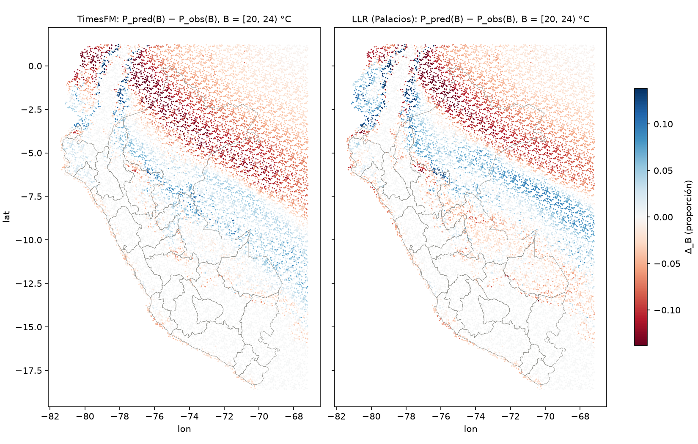
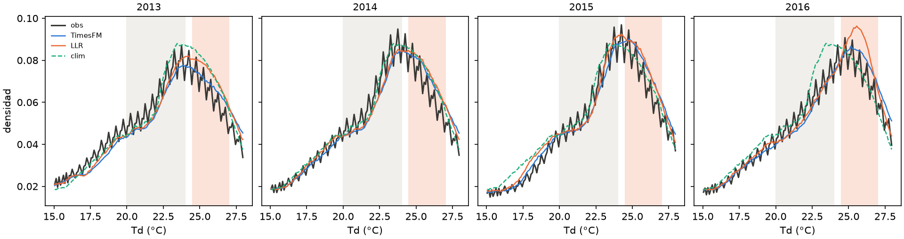
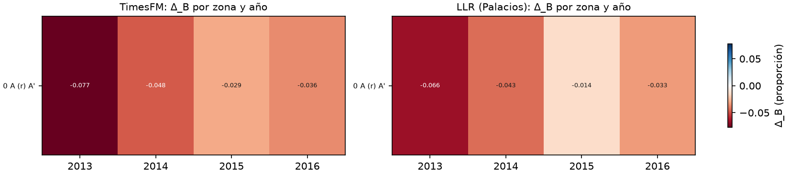

# Divergencia cálida de Td: ¿zonal o temporal?

Bead `tdew-214.19`. Generado el 22 de octubre de 2026 sobre el backtest limpio `ll4`
(2013–2016).

## Objetivo

El histograma nacional de Td de [`kl_limpio/kl_hist_limpio.csv`](../kl_limpio/kl_hist_limpio.csv)
muestra que TimesFM (`tmin_anom_full`) y el método de Palacios (LLR, `pred_tuned`) ponen
menos masa de la observada en B = [20, 24) °C y más de la observada en B' = [24,5, 27] °C.
Aquí se corta esa señal por espacio y por tiempo para responder tres preguntas: si se
concentra en zonas o en años, en qué zonas, y si es común a los dos métodos. La
climatología (`pred_clim`) se incluye como referencia.

## Datos y método

Se usan los mismos 24.876.447 pares celda-día y las mismas 17.027 celdas que `kl.py`,
con el mismo filtro. Palacios se lee de
`backtest_clean/ll4/predictions.parquet` y TimesFM de
`preds_nacional/ll4__tmin_anom_full.parquet` (rutas completas en los
`.provenance.json`). El histograma nacional de este directorio
([`hist_nacional.csv`](hist_nacional.csv)) reproduce `kl_hist_limpio.csv` bin a bin.

Para cada grupo g (una zona, un año, etc.) y cada método:

- `delta_B = P_pred(B) − P_obs(B)`, fracción de los pares del grupo que el método pone en
  B menos la fracción observada. Negativo significa masa de menos en B. `delta_Bp` es lo
  mismo para B'.
- `share_B = n_g · delta_B / Σ n · delta_B` (suma nacional del mismo método): parte del
  déficit nacional que aporta el grupo. En un corte que parte todas las filas, los
  `share` suman 1; un grupo puede pasar de 1 si otros grupos tienen signo contrario. Para
  la climatología el denominador nacional es positivo, de modo que su `share` se lee al
  revés que el de los otros dos métodos.
- `kl_B`: contribución de los bins de B a KL(obs ‖ método) dentro del grupo (bins de
  0,5 °C, suavizado de Jeffreys, misma fórmula que `kl.py`).
- Sesgo condicional: `bias_obs_B = media(pred − obs | obs en B)` y
  `bias_pred_Bp = media(obs − pred | pred en B')`. El primero dice cuánto se calienta la
  predicción en los días que de verdad caen en B; el segundo, si los días que el método
  pone en B' eran en realidad más fríos (negativo) o más cálidos (positivo).
- IC 95 % de `delta_B` por zona y por año, con bootstrap de bloques (200 réplicas,
  semilla 0) en dos esquemas: bloques espaciales de 2 grados y bloques mes-año, el mismo
  esquema de `experiments.amenazas.desglose`. Se remuestrean los bloques del grupo con
  conteos agregados por bloque.

Cortes: zona climática SENAMHI, banda de altitud (DEM), departamento, nivel de soporte
(`tier`), año, mes, año-mes y zona × año. El corte zona × año se limita a las zonas que,
ordenadas por `share_B` de TimesFM, suman el 80 % del déficit nacional; la zona 0 sola
ya pasa ese umbral, así que el corte contiene una única zona.

Reproducción (en tmux, según la regla del proyecto):

```bash
tmux new-session -d -s tdew-214.19-kl-calido 'bash experiments/timesfm/scripts/16_kl_calido.sh'
# equivalente directo:
uv run python -m experiments.timesfm.kl_calido --n-boot 200
```

Código: [`experiments/timesfm/kl_calido.py`](../../../experiments/timesfm/kl_calido.py).
Pruebas: `tests/test_kl_calido.py` y `tests/test_kl_calido_provenance.py`.

Una auditoría independiente comprobó que `hist_nacional.csv` coincide con
`kl_hist_limpio.csv`, que los `share` suman 1 en cada corte, que un recálculo puntual
desde los parquets crudos coincide hasta 1e-5 y que los intervalos bootstrap contienen
la estimación puntual.

## Señal nacional

| método | P(B) | Δ_B | P(B') | Δ_B' |
|---|---|---|---|---|
| observado | 0,2479 | | 0,1745 | |
| TimesFM | 0,2309 | −0,0170 | 0,1877 | +0,0132 |
| LLR | 0,2353 | −0,0126 | 0,1959 | +0,0214 |
| clim | 0,2560 | +0,0081 | 0,1847 | +0,0102 |

TimesFM y LLR comparten el patrón: masa de menos en B y de más en B'. La climatología
también pone masa de más en B', pero en B tiene exceso, no déficit.

## Resultados por espacio

### Zona climática

Zonas con efecto apreciable (de 33 zonas; el resto tiene Δ_B cercano a 0 o casi ningún
día observado en B):

| zona | celdas | P_obs(B) | método | Δ_B | IC 2° | IC mes-año | share_B | Δ_B' | share_B' |
|---|---|---|---|---|---|---|---|---|---|
| 0 A (r) A' | 7.091 | 0,207 | TimesFM | −0,048 | [−0,060, −0,033] | [−0,064, −0,033] | 1,165 | +0,029 | 0,910 |
| | | | LLR | −0,039 | [−0,051, −0,025] | [−0,057, −0,025] | 1,289 | +0,056 | 1,093 |
| | | | clim | −0,011 | [−0,033, +0,019] | [−0,032, +0,009] | −0,553 | +0,065 | 2,660 |
| 11 B (r) A' | 3.695 | 0,568 | TimesFM | +0,020 | [+0,008, +0,026] | [−0,007, +0,047] | −0,251 | +0,003 | 0,050 |
| | | | LLR | +0,020 | [+0,005, +0,034] | [−0,007, +0,051] | −0,350 | −0,005 | −0,049 |
| | | | clim | +0,064 | [+0,037, +0,085] | [+0,028, +0,100] | 1,698 | −0,058 | −1,223 |
| 28 D (i, p) A' | 491 | 0,553 | TimesFM | −0,023 | [−0,064, +0,004] | [−0,050, −0,001] | 0,040 | +0,021 | 0,046 |
| | | | LLR | +0,036 | [−0,013, +0,051] | [+0,007, +0,062] | −0,082 | −0,029 | −0,039 |
| 36 E (d) B' | 991 | 0,092 | TimesFM | −0,009 | [−0,012, −0,006] | [−0,013, −0,004] | 0,031 | 0,000 | 0,000 |
| | | | LLR | −0,012 | [−0,017, −0,008] | [−0,018, −0,008] | 0,057 | 0,000 | 0,000 |

La zona 0, A (r) A' en la notación SENAMHI (muy lluviosa, con lluvia abundante en todas
las estaciones y cálida), concentra la señal en los dos métodos. Aporta más que el
déficit nacional completo (share 1,165 y 1,289) porque la zona 11, B (r) A', tiene el
signo contrario: ahí TimesFM y LLR ponen masa de más en B (+0,020 los dos) y compensan
entre un cuarto y un tercio del déficit. En la zona 0 los dos IC de Δ_B excluyen el 0
para TimesFM y LLR; para la climatología ambos lo incluyen. La zona 0 también reúne casi
todo el exceso en B' (share_B' 0,910 y 1,093), con `kl_B` de 0,054 (TimesFM) y 0,045
(LLR) frente a 0,016 de la climatología.

La zona 28, D (i, p) A', es la única con algo de peso donde los dos métodos discrepan en
signo, pero tiene 491 celdas y su share es menor al 10 %.

El mapa por celda ([`figs/mapa_delta_B.png`](figs/mapa_delta_B.png)) ubica el déficit en
una franja al noreste que va desde el sur de Colombia y Ecuador hasta el norte de Loreto
y el oeste de Brasil, aproximadamente entre 0° y 8° S. Al sur de esa franja aparece otra
con exceso en B, más marcada en LLR, que corresponde a la zona 11.



### Banda de altitud

| DEM (m) | celdas | método | Δ_B | share_B | Δ_B' | share_B' |
|---|---|---|---|---|---|---|
| 0–500 | 11.397 | TimesFM | −0,0259 | 1,020 | +0,0201 | 1,024 |
| | | LLR | −0,0182 | 0,964 | +0,0328 | 1,025 |
| | | clim | +0,0182 | 1,494 | +0,0163 | 1,067 |
| 500–1500 | 1.537 | TimesFM | +0,0059 | −0,031 | −0,0034 | −0,024 |
| | | LLR | +0,0003 | −0,002 | −0,0058 | −0,024 |
| 1500–2500 | 918 | TimesFM | −0,0029 | 0,009 | −0,0001 | 0,000 |
| | | LLR | −0,0081 | 0,035 | −0,0001 | 0,000 |

Por encima de 2.500 m casi no hay días en B. La banda de 0 a 500 m lleva todo el
déficit en B y todo el exceso en B' de los dos métodos.

### Departamento y fuera de Perú

| departamento | celdas | pares | método | Δ_B | share_B | Δ_B' | share_B' |
|---|---|---|---|---|---|---|---|
| fuera_peru | 8.755 | 12.791.055 | TimesFM | −0,0220 | 0,666 | +0,0093 | 0,362 |
| | | | LLR | −0,0129 | 0,527 | +0,0219 | 0,527 |
| Loreto | 2.379 | 3.475.719 | TimesFM | −0,0452 | 0,372 | +0,0736 | 0,781 |
| | | | LLR | −0,0279 | 0,309 | +0,0867 | 0,566 |
| Ucayali | 664 | 970.104 | TimesFM | +0,0109 | −0,025 | −0,0255 | −0,075 |
| | | | LLR | −0,0188 | 0,058 | −0,0235 | −0,043 |
| Madre de Dios | 535 | 781.635 | TimesFM | +0,0066 | −0,012 | −0,0208 | −0,050 |
| | | | LLR | −0,0159 | 0,040 | −0,0245 | −0,036 |

El 51 % de las celdas (8.755 de 17.027) cae fuera de Perú, en la parte de la grilla que
cubre Ecuador, Colombia y Brasil, y aporta dos tercios del déficit de TimesFM y la mitad
del de LLR. Dentro de Perú el déficit es prácticamente todo de Loreto (0,372 y 0,309);
los demás departamentos suman un share neto cercano a cero o negativo. Ucayali y Madre
de Dios muestran signo contrario entre métodos, con magnitudes pequeñas.

### Nivel de soporte

| tier | celdas | Δ_B TimesFM | share TimesFM | Δ_B LLR | share LLR |
|---|---|---|---|---|---|
| within | 8.306 | −0,0116 | 0,334 | −0,0122 | 0,473 |
| near | 1.779 | −0,0205 | 0,126 | −0,0296 | 0,246 |
| marginal | 1.433 | −0,0185 | 0,092 | −0,0212 | 0,141 |
| extrapolated | 2.563 | −0,0176 | 0,156 | −0,0110 | 0,131 |
| unsupported | 2.946 | −0,0288 | 0,293 | −0,0006 | 0,009 |

El déficit aparece en todos los niveles de soporte para TimesFM. LLR casi no lo tiene en
las celdas `unsupported` (−0,0006), donde TimesFM tiene su mayor Δ_B. El nivel de
soporte depende de la distancia a las estaciones y por tanto de la geografía; este corte
no separa el efecto del soporte del efecto de la zona.

## Resultados por tiempo

### Año

| año | método | Δ_B | IC 2° | IC mes-año | share_B | Δ_B' |
|---|---|---|---|---|---|---|
| 2013 | TimesFM | −0,0197 | [−0,041, −0,002] | [−0,033, −0,005] | 0,289 | +0,0090 |
| | LLR | −0,0142 | [−0,031, −0,001] | [−0,027, +0,000] | 0,282 | +0,0218 |
| | clim | +0,0030 | [−0,018, +0,020] | [−0,017, +0,026] | 0,093 | +0,0243 |
| 2014 | TimesFM | −0,0206 | [−0,030, −0,012] | [−0,043, −0,002] | 0,302 | +0,0140 |
| | LLR | −0,0178 | [−0,028, −0,008] | [−0,042, −0,002] | 0,353 | +0,0181 |
| | clim | −0,0031 | [−0,016, +0,010] | [−0,026, +0,012] | −0,094 | +0,0164 |
| 2015 | TimesFM | −0,0129 | [−0,020, −0,007] | [−0,029, +0,001] | 0,190 | +0,0164 |
| | LLR | −0,0062 | [−0,015, +0,003] | [−0,023, +0,010] | 0,123 | +0,0179 |
| | clim | +0,0079 | [−0,010, +0,032] | [−0,018, +0,031] | 0,243 | +0,0046 |
| 2016 | TimesFM | −0,0149 | [−0,025, −0,008] | [−0,028, −0,002] | 0,219 | +0,0132 |
| | LLR | −0,0122 | [−0,021, −0,005] | [−0,025, −0,000] | 0,242 | +0,0279 |
| | clim | +0,0247 | [+0,004, +0,043] | [−0,001, +0,056] | 0,758 | −0,0044 |

TimesFM y LLR tienen Δ_B negativo y Δ_B' positivo los cuatro años. Ningún año domina:
los shares de TimesFM van de 0,19 a 0,30 y los de LLR de 0,12 a 0,35. Con bloques
espaciales, el IC de TimesFM excluye el 0 los cuatro años y el de LLR en tres (2015 no).
Con bloques mes-año los intervalos son más anchos y el 0 queda dentro o en el borde en
2015 para TimesFM y en 2013, 2015 y 2016 para LLR. La climatología no tiene un signo
estable entre años.

Las densidades por año ([`figs/densidad_anio.png`](figs/densidad_anio.png)) muestran el
mismo desplazamiento hacia B' en los cuatro paneles. En 2016 la curva de LLR tiene un
pico en torno a 25,5 °C que no tiene la observada.



### Mes

| mes | Δ_B TimesFM | Δ_B LLR | Δ_B clim | share TimesFM | share LLR |
|---|---|---|---|---|---|
| ene | +0,0062 | −0,0028 | +0,0460 | −0,031 | 0,019 |
| feb | −0,0156 | −0,0213 | +0,0349 | 0,071 | 0,131 |
| mar | −0,0454 | −0,0450 | −0,0112 | 0,227 | 0,303 |
| abr | −0,0346 | −0,0227 | −0,0040 | 0,167 | 0,148 |
| may | −0,0176 | −0,0132 | −0,0091 | 0,088 | 0,089 |
| jun | −0,0171 | −0,0079 | −0,0021 | 0,083 | 0,052 |
| jul | −0,0159 | −0,0064 | +0,0087 | 0,079 | 0,043 |
| ago | −0,0130 | −0,0059 | +0,0077 | 0,065 | 0,040 |
| sep | −0,0159 | −0,0065 | −0,0025 | 0,077 | 0,042 |
| oct | −0,0041 | −0,0002 | +0,0101 | 0,021 | 0,001 |
| nov | −0,0095 | −0,0043 | +0,0166 | 0,046 | 0,028 |
| dic | −0,0215 | −0,0157 | +0,0043 | 0,108 | 0,106 |

El déficit es negativo en once meses para TimesFM (enero es la excepción) y en los doce
para LLR. Marzo y abril juntos aportan el 39 % del déficit de TimesFM y el 45 % del de
LLR. Después siguen diciembre en TimesFM (−0,0215) y febrero en LLR (−0,0213). Octubre es el mes con menos déficit en los
dos métodos.

### Año × mes

El mes-año más negativo es marzo de 2014 para los tres métodos: −0,124 (TimesFM),
−0,127 (LLR) y −0,100 (clim). Que la climatología también falle ese mes es consistente
con un marzo observado atípico respecto del clima medio, y no con un defecto propio de
TimesFM o LLR. El promedio de marzo depende mucho de ese mes: en 2013 marzo tuvo Δ_B
positivo en los dos métodos (+0,019 y +0,017).

| año | feb TimesFM | mar TimesFM | abr TimesFM | feb LLR | mar LLR | abr LLR |
|---|---|---|---|---|---|---|
| 2013 | −0,046 | +0,019 | −0,004 | −0,060 | +0,017 | +0,011 |
| 2014 | −0,006 | −0,124 | −0,050 | −0,004 | −0,127 | −0,029 |
| 2015 | −0,008 | −0,065 | −0,048 | −0,002 | −0,060 | −0,052 |
| 2016 | −0,003 | −0,012 | −0,037 | −0,019 | −0,011 | −0,021 |

De los 48 meses-año, Δ_B es negativo en 38 para TimesFM, en 33 para LLR y en 24 para la
climatología. Abril es negativo los cuatro años en TimesFM; febrero, en los dos métodos.

## Interacción zona × año (zona 0)

| año | Δ_B TimesFM | Δ_B LLR | Δ_B clim | share TimesFM | share LLR | bias_pred_Bp TimesFM | bias_pred_Bp LLR |
|---|---|---|---|---|---|---|---|
| 2013 | −0,077 | −0,066 | −0,051 | 0,473 | 0,544 | −0,609 | −0,269 |
| 2014 | −0,048 | −0,043 | −0,021 | 0,292 | 0,356 | −0,165 | −0,011 |
| 2015 | −0,029 | −0,014 | +0,019 | 0,177 | 0,118 | +0,094 | +0,382 |
| 2016 | −0,036 | −0,033 | +0,009 | 0,224 | 0,270 | −0,149 | +0,242 |

En la zona 0 el déficit tiene el mismo signo los cuatro años en los dos métodos, pero su
magnitud varía: el año más fuerte (2013) es 2,7 veces el más débil (2015) en TimesFM y
4,6 veces en LLR. La climatología también tiene déficit en la zona 0 en 2013 y 2014
(−0,051 y −0,021), lo que sugiere que parte de la variación entre años viene de cuánto se
aparta la Td observada de cada año de su clima medio en esa zona.



## LLR frente a TimesFM frente a la climatología

El déficit en B y el exceso en B' son comunes a TimesFM y LLR, en la misma zona, en la
misma banda de altitud y en los mismos años. TimesFM tiene un déficit nacional mayor
(−0,0170 contra −0,0126) y LLR un exceso en B' mayor (+0,0214 contra +0,0132).

El sesgo condicional separa los dos mecanismos en la zona 0. En los días que de verdad
caen en B, los dos calientan la predicción (`bias_obs_B` +0,758 °C TimesFM, +0,657 °C
LLR). En los días que cada método pone en B', el signo difiere: para TimesFM la Td
observada es 0,195 °C más fría que la predicha (`bias_pred_Bp` −0,195), lo que es
consistente con días de B empujados hacia arriba; para LLR es 0,095 °C más cálida
(+0,095), lo que es consistente con días más cálidos que B' atraídos hacia el centro de
la distribución. Ese contraste no se sostiene todos los años: en 2013 los dos son
negativos y en 2015 los dos positivos (tabla anterior).

La climatología no muestra un déficit consistente en B: su Δ_B nacional es positivo
(+0,0081), cambia de signo entre años y entre meses, y su IC en la zona 0 incluye el 0.
Su exceso nacional en B se concentra en la zona 11 (+0,064) y en la zona 28 (+0,157).
Sí comparte con los otros dos el exceso en B' (+0,0102 nacional, +0,065 en la zona 0).

## Respuesta

La señal es sobre todo espacial. El déficit en B y el exceso en B' de TimesFM y LLR se
concentran en la zona 0, A (r) A', por debajo de 500 m, en la franja amazónica del
noreste de la grilla (norte de Loreto y las zonas vecinas de Ecuador, Colombia y Brasil).
Fuera de esa zona el efecto es pequeño o tiene signo contrario (zona 11).

En el tiempo la señal se repite: aparece los cuatro años y en casi todos los meses, con
máximo en marzo y abril y valores apreciables en febrero y diciembre. La intensidad
varía entre años (2013 la más fuerte en la zona 0, 2015 la más débil), y el mes-año más
negativo, marzo de 2014, también lo es para la climatología. No se encontró un año o un
mes que explique por sí solo el patrón nacional.

El patrón es común a los dos métodos en dónde y cuándo ocurre. Difiere en cómo: en la
zona 0 TimesFM tiende a predecir B' en días observados más fríos y LLR en días
observados más cálidos.

## Limitaciones

- El 51 % de las celdas (8.755 de 17.027, 12,79 millones de pares) está fuera de Perú y
  aporta el 67 % del déficit de TimesFM y el 53 % del de LLR. Todos los cortes salvo el
  departamental mezclan celdas dentro y fuera de Perú; la zona 0 y la banda de 0–500 m
  incluyen ambas. Para una afirmación sobre Perú solo, el dato utilizable es el de
  Loreto.
- El corte zona × año tiene una sola zona, porque la zona 0 supera sola el 80 % del
  déficit. No hay comparación entre zonas año a año.
- Los IC con bloques mes-año son más anchos que los espaciales, porque hay pocos bloques
  temporales (12 por año, 48 por zona). Varios intervalos anuales tocan o incluyen el 0
  con ese esquema.
- La curva observada de [`figs/densidad_anio.png`](figs/densidad_anio.png), en bins de
  0,1 °C, tiene forma de serrucho; es probable que se deba a la cuantización de los
  valores de Td observada. Las tablas usan bins de 0,5 °C o bandas de 4 °C y 2,5 °C, que
  no dependen de ese detalle.
- El análisis describe dónde y cuándo está la diferencia de masa. No atribuye causas: no
  se probó si el efecto viene de la covariable Tmin, de la falta de estaciones en la
  Amazonía, del producto de Td observado en esa región o del método.
- Los `share` de un grupo pueden pasar de 1 o ser negativos cuando otros grupos tienen
  signo contrario; deben leerse junto con Δ_B.

## Archivos

| archivo | contenido |
|---|---|
| [`zona.csv`](zona.csv) | métricas por zona SENAMHI, con IC bootstrap |
| [`dem.csv`](dem.csv) | por banda de altitud |
| [`depto.csv`](depto.csv) | por departamento, más `fuera_peru` |
| [`tier.csv`](tier.csv) | por nivel de soporte |
| [`anio.csv`](anio.csv) | por año, con IC bootstrap |
| [`mes.csv`](mes.csv) | por mes |
| [`anio_mes.csv`](anio_mes.csv) | por año y mes |
| [`zona_anio.csv`](zona_anio.csv) | zona 0 por año |
| [`hist_nacional.csv`](hist_nacional.csv) | histograma nacional en bins de 0,5 °C |
| `*.provenance.json` | entradas, commit y parámetros de la corrida |

---

Este documento se redactó con asistencia de IA generativa a partir de los CSV y figuras
de este directorio. Las cifras y su interpretación deben ser validadas por especialistas
en la materia antes de usarse, conforme a la política de uso aceptable de IA de CIP.
